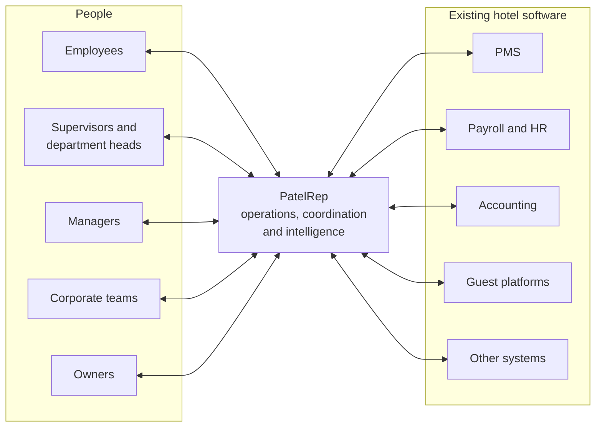

# 01 — Company Vision

> **Status:** The mission, brand promise, platform definition, balance, staffing stance, sales principle and markets
> are founder-approved (FD-16 to FD-22 in the [decision register](15-strategic-decision-register.md#1-founder-approved-decisions)).
> The mechanisms table in §5 is a proposed framing; §11 records repository history.
> **Baseline:** `origin/main` @ `41995dcb` (2026-11-26). **Revised** at `839144cd` (2026-11-26, Phase 0.1, #259): the §11
> adoption note only. **Authority:** [README § Authority and precedence](README.md#authority-and-precedence).

## 1. Mission

**PatelRep's mission is to give everyone in hospitality their time back.**

## 2. Brand promise

**More time for hospitality.**

Hospitality is the work people chose: caring for guests, keeping a building safe and beautiful, leading a team.
PatelRep takes away the work around that work.

## 3. What PatelRep is

PatelRep is an **intelligent hospitality operations and coordination platform**. It connects the people who run a
hotel — employees, supervisors, managers, corporate teams and owners — with each other and with the software the
hotel already uses.

## 4. The problem PatelRep solves

Hotel teams lose time to work that does not need them:

* **Administrative work** — logs, forms, reports and re-typing.
* **Manual coordination** — calls, radio chases and walking to find the right person.
* **Duplicate data entry** — the same fact entered in two or three systems.
* **Waiting** — for a room to be released, a repair to be assigned, an answer to arrive.
* **Rework** — re-cleans, repeat repairs and corrections of things that were done but not communicated.
* **Fragmented information** — knowledge spread across people, binders, inboxes and screens.

Short staffing makes every lost minute more expensive. PatelRep's job is to give those minutes back.

## 5. How PatelRep gives time back

| Mechanism | What it means | Where it is planned |
|---|---|---|
| Capture once, use everywhere | Facts entered or observed once flow to everyone who needs them | [04](04-platform-architecture.md), [05](05-integration-strategy.md) |
| Route work to the right person | Issues, requests and tasks reach the responsible person without a chase | [03](03-master-product-roadmap.md) workstream 9 |
| Remove waiting | Readiness, handoffs and status changes are visible the moment they happen | [03](03-master-product-roadmap.md) workstreams 9–10 |
| Answer in place | Hotel knowledge and live status are one question away | [06 §5](06-ai-and-autonomy-strategy.md#5-ask-patelrep) |
| Automate safely | Routine follow-up and coordination are delegated within strict boundaries | [06](06-ai-and-autonomy-strategy.md) |
| Measure and improve | Every claimed gain is measured, and the next opportunity is found | [09](09-performance-and-impact-engine.md) |

## 6. The balance PatelRep keeps

PatelRep balances six outcomes (FD-19): **time savings, guest experience, profitability, operational quality,
safety and employee well-being.**

When they pull against each other, the constitution sets the order: **safety, quality, privacy, employee protection
and truthful information come first** (FD-15, [02](02-product-constitution.md)). Within those limits PatelRep
optimizes for time returned, guest experience and profitability together. A gain in one outcome bought with a loss
in a protected one is not a gain.

## 7. Our stance on short staffing

PatelRep helps hotels address short staffing by eliminating unnecessary administrative work, manual coordination,
duplicate data entry, waiting, rework and fragmented information.

**It never solves staffing problems by encouraging unsafe workloads, sacrificing service quality, pressuring
employees or concealing genuine staffing shortages** (FD-20). When the work cannot be done safely with the people
available, PatelRep says so clearly to the people who can act ([10](10-employee-protection-policy.md)).

## 8. What PatelRep sells

**Measurable results, not AI technology** (FD-21). Customers buy outcomes they can see in their own operation:

* hours returned to their teams;
* rooms ready sooner and fewer status mismatches;
* fewer missed handoffs and repeat defects;
* shortages seen earlier and filled fairly;
* managers spending less time assembling information and more time leading.

AI, integrations and automation are how PatelRep delivers those results. They are never the headline, and no result
is claimed before it is measured ([09](09-performance-and-impact-engine.md)).

## 9. Who PatelRep serves

* **People:** frontline employees in housekeeping, engineering and the front desk; supervisors and department heads;
  general managers and management teams; corporate, accounting and HR staff; and owners.
* **Initial market:** 50–150-room hotels (FD-22).
* **Long-term market:** all hotel types, sizes and ownership structures — independent, franchised, managed, portfolio
  and owner-operated properties.

Earlier repository descriptions narrow the initial market further ("Texas", "independent", "limited/select-service").
Those remain go-to-market context for the first customers, not product boundaries
([CF-05](15-strategic-decision-register.md#9-conflicts-and-recommended-resolutions)).

## 10. What PatelRep is not

* Not a replacement for the PMS, accounting, payroll, revenue management or other systems of record (FD-07).
* Not a competing guest-facing platform (FD-06).
* Not a reason to replace a hotel's existing technology (FD-09).
* Not a surveillance or discipline tool ([10](10-employee-protection-policy.md)).
* Not an AI demonstration. A feature that neither returns time nor measurably improves one of the outcomes in §6 does
  not ship.

## 11. How the vision evolved

The repository has described PatelRep in narrower terms. These statements are consistent with the mission's focus on
the floor but narrower in audience and framed around AI:

| Statement | Source (at the Phase 0 baseline) |
|---|---|
| "AI Staff Copilot SaaS for 50–150 room Texas hotels" | `CLAUDE.md` (line 3) |
| "AI Staff Copilot SaaS for independent Texas hotels. Quore-style simplicity with AI-powered predictions — built for housekeepers and engineers on the floor." | `README.md` (line 3) |
| "PatelRep is an AI staff copilot for 50–150 room Texas hotels…" | `.planning/PROJECT.md` (line 5) |
| "Built for 50–150 room Texas hotels" and "Hotel operations, finally in sync." | `apps/web/app/page.tsx` (public site, asserted by `apps/web/e2e/phase0-public-smoke.spec.ts`) |

This strategy keeps their strengths — floor-first design, simplicity, defensible operational evidence — and changes
the frame: from an AI copilot for two departments to a platform that returns time to everyone in hospitality. Updating
those texts (and the public-site test that asserts one of them) is a reviewed follow-up recorded as
[CF-01](15-strategic-decision-register.md#9-conflicts-and-recommended-resolutions). Phase 0.1 (#259) updated
`CLAUDE.md` and `README.md`; `.planning/PROJECT.md` and the public site remain open.

## 12. The principle behind every document

**PatelRep exists to give people their time back.** AI, integrations, agents, automation, analytics and development
infrastructure are mechanisms for accomplishing that mission, not the mission itself.
