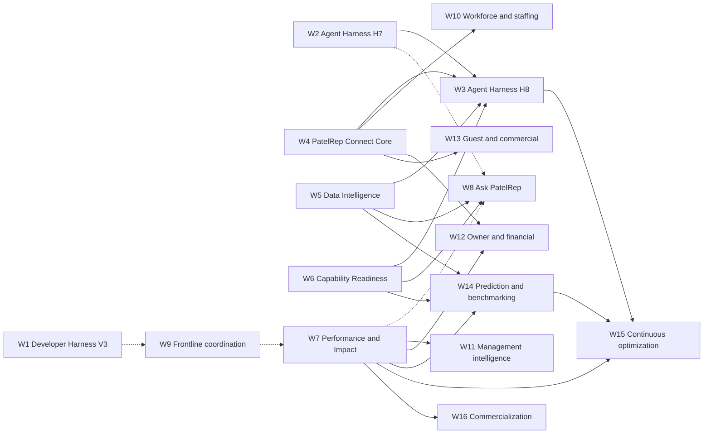

# 03 — Master Product Roadmap

> **Status:** The sixteen workstreams and their dependency-aware (not strictly sequential) character are
> founder-approved ([FD-37](15-strategic-decision-register.md#1-founder-approved-decisions)).
> Dependencies, waves, milestones and gates are **proposed** (PA-17). This is a dependency-aware plan, not a commitment
> to strictly sequential delivery, and it does not redesign the H7, H8 or V3 contracts it references.
> **Baseline:** `origin/main` @ `41995dcb` (2026-11-26). **Revised** at `839144cd` (2026-11-26, Phase 0.1, #259): D3.6
> status in §1, §3 and W1 only. **Authority:** [README § Authority and precedence](README.md#authority-and-precedence).

## 1. How to read this roadmap

* Workstreams are identified W1–W16; milestones as `W4-C2`, and so on. Component phases keep their own names (H7 P3,
  D3.6) so the many existing "phase" schemes are never confused ([CF-10](15-strategic-decision-register.md#9-conflicts-and-recommended-resolutions)).
* **Customer value before infrastructure.** A foundation milestone is scheduled when a customer-facing milestone needs
  it, not before.
* **No premature intelligence.** An agent or prediction whose required data is unavailable, or whose usefulness cannot
  be validated, is not built ([07](07-adaptive-intelligence.md), [14 §6](14-development-and-acceptance-standards.md#6-evaluation-requirements-for-ai-features)).
* Nothing here starts work. Recording D3.6's post-merge verification (its owner steps are in
  [developer-harness-v3/40 §7.8](../developer-harness-v3/40-d36-verification-evidence.md#78-post-merge-verification-cannot-be-shown-before-merge)),
  D3.7–D3.9, H7 implementation, H8 implementation and every product milestone begin only on an explicit request,
  through the normal development routing in `CLAUDE.md`. D3.6 itself merged on 2026-11-26 but is not complete until
  that verification is recorded.

## 2. Dependency map

Solid arrows are hard prerequisites for the dependent workstream's later milestones; dotted arrows accelerate or
enrich but do not block. W1 accelerates every workstream through better tooling, shown once to keep the graph legible;
it blocks none of them because Developer Harness V2 stays authoritative until V3 is activated.

## 3. Waves (planning groupings, not dates)

| Wave | Content | Why now |
|---|---|---|
| 0 — Preparation | This strategy; pilot authorization request to the property; baseline design; partner and developer-account applications by the founder; authorized hotel research | Needs no code; baseline *measurement* waits for the pilot's P0 approvals |
| 1 — Foundations beside value | W1 D3.6 (merged 2026-11-26, inactive); W2 H7 P3–P5; W4-C1–C2; W5-D1–D2; W6-R1–R2; W7-I1–I3 (I2 owns all instrumentation); W9-F1–F4; W10-L1; W11-M1 | Each foundation milestone serves a pilot workflow |
| 2 — Pilot and proof | Pilot P1–P4 ([12](12-customer-pilot-strategy.md)); W2 H7 P6–P8; W4-C3; W5-D3; W7-I4–I6; W8-A1–A2 | Evidence before expansion; completes the foundations H8 needs (§4) |
| 3 — Expansion | W3-N1–N4; W8-A3–A4; W10-L3–L4; W12-O1–O3; W13-G1–G3; W14-X1–X2 | Built on measured results and proven foundations |
| 4 — Scale | W15; W16; W14-X3–X4; W3-N5–N6 | Requires customers, consent and validated autonomy |

Milestones not listed in a wave (for example D3.7–D3.9, W4-C4–C6, W5-D4–D5, W6-R3–R5, W8-A5–A6, W10-L2 and L5,
W11-M2–M4, W12-O4–O5, W13-G4) are unscheduled; each is placed when a customer-facing milestone needs it.

## 4. Foundations that must precede H8, and work that can overlap

**Must precede H8 (W3) milestones that use them:**

1. **H7 complete through P8** — bounded autonomy proven in shadow mode and a staging rehearsal; H8 depends on H7
   ([agent-harness/roadmap.md](../agent-harness/roadmap.md)).
2. **Connect Core contracts and the external-action authorization model (W4-C1–C3)** — before any Connect, Guest,
   Growth or Owner agent reads integration data.
3. **Capability readiness contract (W6-R1–R2)** — before any H8 agent declares what it needs.
4. **Provenance and permission-scoped retrieval (W5-D2–D3)** — before persistent memory with trust boundaries.
5. **Metric registry and validation records (W7-I1, I6)** — before coordinated autonomy is evaluated.
6. **Encoded FD-23 restrictions** — explicit prohibited rows for autonomous telephony and vendor communication, with a
   contract test ([CF-11](15-strategic-decision-register.md#9-conflicts-and-recommended-resolutions)), before W3-N1 exits.

**Can safely overlap:**

* W1 with everything: it is a separate development plane and V2 governs meanwhile.
* W4 read-side, W5, W6 and W7 contracts with H7 P3–P8: different code paths. Migration numbers are assigned only when a
  phase starts, after re-checking `main` (the H7 rule that avoided a repeat of the #239 → 261 renumbering).
* W9 with all foundations, provided its operations follow the AI-ready standard and emit instrumentation events.
* W8-A1 (read-only answers) with H7: it needs no autonomy.
* Pilot preparation, baseline design and partner applications at any time; baseline measurement begins early, as
  soon as the property's P0 approvals allow (FD-37, FD-38).

**Must not overlap:**

* Two security-sensitive migrations under review that touch the same agent tables; each needs its own reviewed
  staging preview ([STAGING_REVIEWED_MIGRATION_PREVIEW.md](../STAGING_REVIEWED_MIGRATION_PREVIEW.md)).
* Any activation step with an open readiness review or an unresolved incident.

## 5. Workstreams

### W1 — Complete and validate Developer Harness V3

| Field | Content |
|---|---|
| Objective | Record D3.6's post-merge verification, then finish D3.7–D3.9, so autonomous development can be activated inside proven isolation; V2 stays authoritative until then |
| Customer value | Indirect: faster, safer delivery and maintenance of every other workstream |
| Intended users | The founder as repository owner, and developer agents |
| Existing foundation | D3.2 (#251), D3.3 (#252), D3.4 (#254), D3.5 (#255) and D3.6 (#257 delivery and #258 protected control-plane integration, both merged 2026-11-26) on `main` — implemented, D3.4–D3.6 simulated, all inactive; V2 core, CI integration and permission transition merged (#247, #250, #253) |
| Missing capabilities | D3.6 post-merge verification ([40 §7.8](../developer-harness-v3/40-d36-verification-evidence.md#78-post-merge-verification-cannot-be-shown-before-merge)); D3.7 merging, releases, recovery ([41-d37-handoff.md](../developer-harness-v3/41-d37-handoff.md)); D3.8 bot, dashboard, maintenance; D3.9 validation, audit, activation ([09-roadmap.md](../developer-harness-v3/09-roadmap.md)) |
| Dependencies | Owner decisions on provider eligibility, worker account and egress rule, publisher credentials, the live remote-state reader and owner-action evidence ([39 §3](../developer-harness-v3/39-d36-protected-integration.md#3-owner-decisions-that-remain-not-routine-engineering)); recorded post-merge verification of the protected CI wiring (#258, G-V3-CI) |
| Required data and integrations | Developer subscription and CLI, GitHub; host resources (a real low-memory interruption is recorded in [23-d35-handoff.md](../developer-harness-v3/23-d35-handoff.md)) |
| Security and authorization | V3 authority contract; developer agents never activate customer execution; bypass only inside proven isolation (G-BYPASS-ACTIVATION) |
| Implementation milestones | D3.6 (merged) → D3.7 → D3.8 → D3.9, each only on owner instruction |
| Acceptance criteria | Every gate in the code-rendered activation register closed (`scripts/developer-harness-v3/orchestrator/activation-gates.mjs`: 28 gates at the Phase 0 baseline and 31 at `839144cd`, none closed; described in [21 §5](../developer-harness-v3/21-d34-protected-changes.md)); D3.9 end-to-end validation and security audit |
| Evaluation requirements | V3 suites in protected CI; live-adapter proof; recovery acceptance scenarios |
| Rollout and activation gates | D3.9 owner activation ceremony |
| Key risks | Isolation on the available host; resource exhaustion; provider-terms eligibility; review capacity |
| Deferred | Everything beyond D3.9; this strategy starts none of it |

### W2 — Resume and complete Customer Agent Harness H7

| Field | Content |
|---|---|
| Objective | Bounded autonomy (level 3) for expressly granted, low-risk, internal operational tools |
| Customer value | Routine internal follow-ups happen without a manager approving each one |
| Intended users | Managers granting autonomy; supervisors and engineers receiving the help |
| Existing foundation | H0–H6 merged, default-disabled; H7 P1 contracts (#243) and P2 verified human identity (migration 262, #245) merged |
| Missing capabilities | P3 autonomy schema; P4 manifest v2; P5 enforcement RPC and first candidate tool (disabled); P6 shadow mode; P7 notification outbox and grant UI; P8 staging rehearsal ([h7-rollout-plan.md](../agent-harness/h7-rollout-plan.md)) |
| Dependencies | H6 and P2 (done); step-up authentication decision before any production issuance; correct classification of new forward-only migrations in developer tooling (V2 finding R-06, [01-verification-register.md](../developer-harness-v3/01-verification-register.md)) |
| Required data and integrations | Internal operational data only |
| Security and authorization | Default deny; database as final enforcement; never wildcard; expiring grants; human-authority consequences never level 3; production-stamped databases refuse issuance until step-up exists |
| Implementation milestones | P3, P4, P5, P6, P7, P8 |
| Acceptance criteria | Phase exit criteria in the rollout plan; the required real-database tests of the authorization contract |
| Evaluation requirements | Human review of shadow decisions on a seeded staging hotel; chaos tests (revoke or pause mid-transaction, lease loss, crash after commit) |
| Rollout and activation gates | Reviewed staging preview per security-sensitive migration; production is a separate decision after P8 |
| Key risks | Pause and revoke races, quota bypass, privilege drift, migration renumbering |
| Deferred | Delegation beyond depth 0 (H8); any medium-or-higher-risk tool at level 3 (never in H7) |

### W3 — Develop Customer Agent Harness H8

| Field | Content |
|---|---|
| Objective | Coordinated autonomy (level 4), cross-product agents (Guest, Growth, Owner, Connect), persistent memory with trust boundaries |
| Customer value | Multi-step, cross-department coordination without people relaying messages |
| Intended users | All roles indirectly; managers configure and govern |
| Existing foundation | H3 plans enforce delegation depth 0 in code (`services/agent_orchestrator/plans.py`); the H7 design reserves delegation columns at depth 0 (ADR-0006 D1; not yet implemented); `TriggerType` includes `schedule` and `event`; `ProductFamily` includes guest, growth, owner and connect |
| Missing capabilities | H8 ADR, threat and risk models, delegation schema, memory design, cross-product manifests, the People family decision ([CF-04](15-strategic-decision-register.md#9-conflicts-and-recommended-resolutions)) |
| Dependencies | W2 through P8; W4-C1–C3; W5-D2–D3; W6-R1–R2; W7-I1, I6; encoded FD-23 restrictions (§4) |
| Required data and integrations | Per agent, declared through readiness |
| Security and authorization | Every effect through the Tool Gateway; human-authority consequences stay human; guest communication, PMS and financial writes stay prohibited unless a future reviewed risk model changes them; FD-23 restrictions hold |
| Implementation milestones | Indicative only — the H8 ADR, once written, is authoritative: N1 ADR and models (design only); N2 memory as data, never authority; N3 operations-only coordination in shadow mode; N4 first read-only cross-product agents; N5 staging rehearsal; N6 activation decision |
| Acceptance criteria | Real-database, chaos and shadow-review evidence comparable to H7 |
| Evaluation requirements | Task success, escalation correctness, zero unauthorized effects, cost per coordinated outcome |
| Rollout and activation gates | Per-hotel explicit activation after shadow mode |
| Key risks | Emergent cross-agent behavior; memory poisoning; scope creep; cost |
| Deferred | Guest-facing or external-communication autonomy; autonomous calls and vendor communication |

### W4 — Build PatelRep Connect Core

| Field | Content |
|---|---|
| Objective | A reusable, authorized integration framework ([05](05-integration-strategy.md)) |
| Customer value | Hotels keep their software and stop entering the same fact twice; capabilities light up as systems connect |
| Intended users | GMs and owners connecting software; every role through synced data |
| Existing foundation | OPERA (OHIP arrivals sync for today and tomorrow, webhooks, SFTP report ingestion, PDF import), Stripe, Twilio, Resend, Expo push — provider-specific, no shared framework |
| Missing capabilities | Connector SDK, provider and capability registries, canonical models, identity mapping, sync and conflict policy, health, credentials, metering, onboarding, lifecycle testing |
| Dependencies | Provider access obtained by the founder (ED-01 to ED-06); W6 declarations in parallel |
| Required data and integrations | PMS first (pilot), then payroll and timekeeping, accounting, guest platforms, revenue and reputation |
| Security and authorization | Adapter-owned credentials, least privilege, consent, revocation, untrusted payloads, reviewed external writes; never bypass access restrictions (FD-27) |
| Implementation milestones | C1 contracts; C2 OPERA read paths on the SDK with health; C3 credentials and onboarding for one provider; C4 second provider category; C5 metering and cost governance; C6 compatibility testing and lifecycle |
| Acceptance criteria | Provider-agnostic consumers; outage isolation; no credential in logs, traces or model context; tenant-scoping tests |
| Evaluation requirements | Freshness, error rate and reconciliation against the provider's own records |
| Rollout and activation gates | Per-provider entitlements (pattern: `opera_pilot_enabled`); sandboxes only outside production ([ENVIRONMENTS.md](../ENVIRONMENTS.md)) |
| Key risks | External access and certification timelines; provider API changes; partner-program costs |
| Deferred | External writes beyond reviewed operations; UI automation of provider systems |

### W5 — Establish the Data Intelligence foundation

| Field | Content |
|---|---|
| Objective | Authorized ingestion, normalization, history, knowledge retrieval, provenance and quality ([08](08-data-intelligence-strategy.md)) |
| Customer value | Trustworthy answers and analytics; the basis for measurement and prediction |
| Intended users | Every role through Ask PatelRep and the Workspace; managers and owners through analytics |
| Existing foundation | Operational history in Postgres; SOP retrieval on pgvector; validated cleaning estimates; staffing forecast with evidence labels; engineering insights and asset reliability |
| Missing capabilities | Event taxonomy, provenance envelope, quality checks feeding readiness, canonical store for integrated data, retention catalog, knowledge beyond SOPs |
| Dependencies | W4 for external data; W6 consumes quality and freshness |
| Required data and integrations | Native records first, then PMS |
| Security and authorization | Tenant-keyed storage under RLS; no cross-tenant joins; data-use boundaries ([08 §7](08-data-intelligence-strategy.md#7-customer-data-use-boundaries)) |
| Implementation milestones | D1 event taxonomy (the vocabulary W7-I2 instruments); D2 provenance and quality envelope; D3 governed knowledge retrieval beyond SOPs; D4 canonical store for Connect data; D5 retention catalog and deletion jobs |
| Acceptance criteria | Every derived fact traceable to records; quality checks drive readiness; deletion tested |
| Evaluation requirements | Data-quality metrics; retrieval accuracy on evaluation sets |
| Rollout and activation gates | No customer-visible change until a consumer adopts it |
| Key risks | Over-building infrastructure; privacy errors |
| Deferred | Warehouse, streaming and cross-customer analytics until measured need ([04 §8](04-platform-architecture.md#8-scale-triggers-when-to-add-infrastructure)) |

### W6 — Establish Adaptive Intelligence and Capability Readiness

| Field | Content |
|---|---|
| Objective | Declarations, states and deterministic checks for every capability ([07](07-adaptive-intelligence.md)) |
| Customer value | One consistent product that tells the truth at every property |
| Intended users | Every role; engineers declaring capabilities |
| Existing foundation | Null-not-zero metrics, fail-closed flags, soft-skip jobs, honest cron states |
| Missing capabilities | Shared declaration schema, evaluator, integration-health inputs, UI states |
| Dependencies | W4 health inputs (R3); W5 quality inputs |
| Required data and integrations | Flag and entitlement rows, sync timestamps, history coverage |
| Security and authorization | Readiness never grants authority; evaluation failure resolves to `unavailable` |
| Implementation milestones | R1 schema and vocabulary; R2 evaluator; R3 integration health; R4 Workspace UI states; R5 adoption by agents, metrics and Ask PatelRep |
| Acceptance criteria | Per [07 §11](07-adaptive-intelligence.md#11-implementation-path-proposed-milestones) |
| Evaluation requirements | State-precedence and no-model-call tests |
| Rollout and activation gates | Adopted capability by capability behind existing flags |
| Key risks | A second, inconsistent readiness notion per team |
| Deferred | Storage format (TD-12) |

### W7 — Establish the Performance & Impact Engine foundation

| Field | Content |
|---|---|
| Objective | Hours Returned, evidence classes, registry extension, attribution and the improvement cycle ([09](09-performance-and-impact-engine.md)) |
| Customer value | Proof of value in the hotel's own numbers |
| Intended users | Managers and owners; the founder for commercial evidence |
| Existing foundation | Registry of 22 definitions, pure calculators, Management ROI and Intelligence; no time-saved figure exists |
| Missing capabilities | Registry fields, activity taxonomy, instrumentation, baselines, calculator, impact view, validation records |
| Dependencies | W5-D1 taxonomy; W9 features emit the I2 events |
| Required data and integrations | Native timestamps; work sampling in the pilot; payroll data only for realized value |
| Security and authorization | Person-level visibility rules; employee protection review |
| Implementation milestones | I1–I6 ([09 §11](09-performance-and-impact-engine.md#11-implementation-path-proposed-milestones)) |
| Acceptance criteria | Baseline locked before enablement; double-counting and confounder tests |
| Evaluation requirements | Comparison against the pilot measurement plan |
| Rollout and activation gates | Pilot property first |
| Key risks | Inflated or misattributed claims; metrics used for surveillance |
| Deferred | Cross-customer comparisons (W14) |

### W8 — Develop universal Ask PatelRep

| Field | Content |
|---|---|
| Objective | One conversational entry for every authorized user: truthful answers first, then delegation ([06 §5](06-ai-and-autonomy-strategy.md#5-ask-patelrep)) |
| Customer value | Answers in seconds without finding a supervisor; managers get live briefings |
| Intended users | All roles |
| Existing foundation | AI Copilot intents, briefings, recap and cited SOP answers; flagged mobile assistant; on-device voice; credit pre-flight |
| Missing capabilities | Availability for all roles, deterministic tools across domains, readiness-aware answers, provenance, memory, harness delegation, scheduled follow-up |
| Dependencies | W6, W5; W7 for metrics; W2/W3 for delegation; convergence decisions TD-10 and TD-18 |
| Required data and integrations | Native records and SOPs; Connect data where ready |
| Security and authorization | Permission filter before the model; untrusted-content handling; actions only as harness proposals; metering |
| Implementation milestones | A1 read-only answers over deterministic tools and SOPs (pilot); A2 readiness-aware partial answers and citations; A3 live metrics; A4 delegation with human approval; A5 scheduled and event follow-ups; A6 scoped memory (with H8) |
| Acceptance criteria | Evaluation per [14 §6](14-development-and-acceptance-standards.md#6-evaluation-requirements-for-ai-features); zero permission leaks in probes; deterministic answers match the UI |
| Evaluation requirements | Accuracy, refusal correctness, latency, cost per answer, pilot satisfaction |
| Rollout and activation gates | Per-role flags; pilot first |
| Key risks | Hallucination, permission leaks, cost, replacing faster screens |
| Deferred | Autonomous calls and vendor messages (prohibited); public research until a citation policy exists |

### W9 — Improve frontline operations and cross-department coordination

| Field | Content |
|---|---|
| Objective | Remove handoff waste between housekeeping, engineering and the front desk |
| Customer value | Pilot workflows 1–4: handovers, voice issue reporting, coordination, room readiness |
| Intended users | Housekeepers, engineers, front desk, supervisors |
| Existing foundation | Native operations, logbook and AI shift summaries, issue reporting, room discrepancies, realtime room status, escalation ladder, central notification policy |
| Missing capabilities | A "room ready" notification to the front desk; handover carry-over structure; voice reporting beyond current flows; routing improvements; instrumentation events |
| Dependencies | W7-I2 instrumentation (single owner), built on the W5-D1 taxonomy |
| Required data and integrations | Native; PMS optional |
| Security and authorization | Role gates; AI-ready standard for any agent-accessible operation; inspection pass and room release stay human |
| Implementation milestones | F1 room-ready notification; F2 handover improvements; F3 voice reporting expansion; F4 cross-department routing — each emitting the W7-I2 events before its pilot baseline closes |
| Acceptance criteria | Strategy Fit Record; measurable Hours Returned per workflow |
| Evaluation requirements | Pilot measurements ([12](12-customer-pilot-strategy.md)) |
| Rollout and activation gates | Flags and Feature Rollout; pilot property first |
| Key risks | Notification overload; adding taps |
| Deferred | Agent autonomy over room status transitions |

### W10 — Expand workforce and staffing intelligence

| Field | Content |
|---|---|
| Objective | Comprehensive workforce management with payroll integrations and honest staffing intelligence |
| Customer value | Shortages seen early, coverage filled fairly, less schedule admin, accurate pay data flow |
| Intended users | Employees (self-service), schedulers and supervisors, GMs, future HR and accounting roles |
| Existing foundation | Team scheduling, availability, DB-enforced approved leave, swaps, offers, open shifts, coverage gaps, same-day staffing forecast, Smart Balance, housekeeping time clock whose shift-session table is deliberately unlinked from scheduling and payroll (migration 056) |
| Missing capabilities | Payroll and timekeeping integration; time clock beyond housekeeping; forward forecast; onboarding and training beyond safety and evidence; HR roles; break policy |
| Dependencies | W4 (reservations, payroll connectors); W6; W14 for prediction; ED-02; legal review (ED-10); [10](10-employee-protection-policy.md) |
| Required data and integrations | Schedules, attendance, occupancy forecasts, payroll exports |
| Security and authorization | Personnel and financial consequences keep human authority; PII minimization |
| Implementation milestones | L1 shortage reporting and coverage improvements; L2 time clock scope decision with legal review; L3 payroll export before API integration; L4 forward staffing forecast from Connect reservations; L5 onboarding and training workflows |
| Acceptance criteria | Employee protection checklist; no invented capacity; legal sign-off |
| Evaluation requirements | Forecast accuracy, gap fill time, short-notice schedule changes |
| Rollout and activation gates | Per hotel, pilot first |
| Key risks | Wage-and-hour compliance, privacy, fairness |
| Deferred | Automated scheduling decisions without supervisor approval; payroll processing |

### W11 — Develop management intelligence

| Field | Content |
|---|---|
| Objective | Exception-driven management: briefings, impact views, recommendations |
| Customer value | Less time assembling information; problems seen earlier |
| Intended users | GMs, department heads, supervisors |
| Existing foundation | Reports with views, exports and schedules; Management ROI and Intelligence (GM only); daily GM summary email; AI briefings |
| Missing capabilities | Department-head views, a unified exception queue, impact views, the improvement loop, readiness-aware briefings |
| Dependencies | W7, W5, W6; W8 for narrative |
| Required data and integrations | Native first, Connect where ready |
| Security and authorization | Role-scoped visibility; person-level rules |
| Implementation milestones | M1 consolidated morning briefing for the pilot; M2 exception queue; M3 impact view; M4 recommendations with validation |
| Acceptance criteria | Briefings reconcile to records; estimates labeled |
| Evaluation requirements | Time to assemble the morning picture; usage |
| Rollout and activation gates | Pilot first |
| Key risks | Dashboard bloat; false alarms |
| Deferred | Corporate and portfolio views (W12, W16) |

### W12 — Develop owner and financial intelligence

| Field | Content |
|---|---|
| Objective | Property performance, portfolio oversight, asset economics and executive assistance on authorized financial data |
| Customer value | Owners understand performance without assembling reports |
| Intended users | Owners, asset managers, corporate and accounting staff |
| Existing foundation | Downtime revenue exposure (estimate); asset reliability; unused `tenant_groups` table; no accounting integration; no owner role |
| Missing capabilities | New roles (PA-12), portfolio tenancy (PA-11), accounting connectors, financial metric families, executive assistance |
| Dependencies | W4, W5, W7; TD-08, TD-09; ED-03 |
| Required data and integrations | General ledger and P&L through authorized accounting integrations; PMS revenue; payroll |
| Security and authorization | Financial consequence keeps human authority; no financial writes by agents; cross-hotel access tests |
| Implementation milestones | O1 roles and portfolio tenancy design with security review; O2 read-only accounting integration for the pilot owner; O3 owner property view with realized-versus-estimated labels; O4 portfolio rollups; O5 read-only executive assistance |
| Acceptance criteria | Figures reconcile to source systems; labels; access tests |
| Evaluation requirements | Reconciliation error rate; owner usage |
| Rollout and activation gates | Explicit per-owner enablement |
| Key risks | Data-access agreements; accuracy; privacy |
| Deferred | Financial actions |

### W13 — Expand guest and commercial intelligence through integrations

| Field | Content |
|---|---|
| Objective | Coordinate with existing guest and commercial platforms; service recovery and experience, demand, revenue and reputation insight |
| Customer value | Guest issues resolved with less relay; commercial teams informed by operations |
| Intended users | Front desk, GMs, future sales and revenue roles, owners |
| Existing foundation | Guest requests with SLAs; staff-entered feedback score; manual service recovery; staff-initiated guest SMS (Twilio, consent); OPERA rate and block codes ingested only |
| Missing capabilities | Guest-platform connectors, low-score alerts, demand analysis from the PMS, revenue-system read integration |
| Dependencies | W4, W5, W6; ED-04, ED-05; FD-06 |
| Required data and integrations | Guest messages and reviews (untrusted input), reservations, rates |
| Security and authorization | Guest-facing consequences never level 3; agent guest communication is prohibited (H7 risk model); guest data minimal |
| Implementation milestones | G1 decide the future of native SMS ([CF-13](15-strategic-decision-register.md#9-conflicts-and-recommended-resolutions)); G2 read integration with one guest-messaging or reputation platform; G3 service-recovery alerts; G4 demand and revenue insight |
| Acceptance criteria | No duplicate guest-platform functionality; consent and opt-out preserved |
| Evaluation requirements | Resolution time; recovery effectiveness |
| Rollout and activation gates | Per-hotel integration enablement |
| Key risks | Building a guest platform by accretion; guest privacy |
| Deferred | Any agent guest communication (prohibited today; would require a future reviewed risk-model decision) |

### W14 — Develop predictive intelligence and authorized benchmarking

| Field | Content |
|---|---|
| Objective | Validated predictions and opt-in cross-property benchmarks |
| Customer value | Act before problems: failures, shortages, readiness delays |
| Intended users | Managers, engineers, owners |
| Existing foundation | Rule-based room-readiness predictions; nightly asset-failure predictions with rule fallback; cleaning estimates with hold-out validation; trailing-average labor forecast |
| Missing capabilities | Prediction validation records, history-based readiness gates, a consent and aggregation framework for benchmarks (PA-15) |
| Dependencies | W5, W6, W7; enough consenting customers (W16); explicit authorization (FD-29) |
| Required data and integrations | Per-hotel history; consented aggregates |
| Security and authorization | No automatic training on customer data; minimum cohort sizes; no re-identification |
| Implementation milestones | X1 validation records; X2 history gates; X3 consent model with legal review; X4 first opt-in benchmark |
| Acceptance criteria | Predictions beat their baseline on hold-out data (the `cleaning_estimates.py` precedent); benchmarks meet cohort thresholds |
| Evaluation requirements | Accuracy and calibration tracked per version |
| Rollout and activation gates | Each prediction behind its own flag after hold-out validation; benchmarks only for consenting properties after legal review |
| Key risks | False confidence; privacy |
| Deferred | Model training on customer data (needs a future explicit decision) |

### W15 — Expand continuous optimization and coordinated autonomy

| Field | Content |
|---|---|
| Objective | Run the improvement cycle at scale: detect, recommend, execute within authority, validate |
| Customer value | Compounding time returned |
| Intended users | Managers; agents within their grants |
| Existing foundation | Reporting and the H-series contracts only |
| Missing capabilities | Improvement records, activated level 3 and level 4 per hotel, validation at scale |
| Dependencies | W3, W7, W14 |
| Required data and integrations | Registered metrics and validation records (W7), plus each improvement's declared readiness inputs |
| Security and authorization | Every execution through the harness: level 3 only for low-risk internal effects under expiring per-hotel grants; level 4 only after H8; human-authority consequences never automated |
| Implementation milestones | K1 cycle with human execution; K2 bounded execution of validated low-risk improvements; K3 coordinated workflows |
| Acceptance criteria | Every "achieved" improvement has a validation record |
| Evaluation requirements | Hours Returned trend; reversal rate |
| Rollout and activation gates | Expiring per-hotel grants |
| Key risks | Over-automation; optimizing the metric instead of the outcome |
| Deferred | Autonomy over human-authority consequences (never) |

### W16 — Commercialization and scaling

| Field | Content |
|---|---|
| Objective | Turn pilot evidence into a sustainable, scalable business ([11](11-commercial-strategy.md)) |
| Customer value | More hotels get time back |
| Intended users | The founder; future sales, onboarding and support staff |
| Existing foundation | Legacy billing, onboarding flow and assistant, 30-day trial, OPERA PDF import, Design System V2, public site |
| Missing capabilities | All-inclusive pricing; self-service integration onboarding; support processes; compliance assessments ([13 §9](13-security-privacy-and-governance.md#9-compliance-considerations-to-be-assessed-nothing-is-claimed-today)); jurisdiction-aware compliance content (the safety module is Texas-framed); a decision on the small-property cap defect (CF-02) |
| Dependencies | Pilot evidence; OC-01 to OC-12; W4-C3; ED-10 |
| Required data and integrations | Billing and cost ledgers; customer outcomes |
| Security and authorization | Tenant isolation at scale; reviewed billing changes |
| Implementation milestones | S1 commercial decision package; S2 billing implementation with staged activation; S3 onboarding playbook and self-service; S4 support and incident processes; S5 market-expansion readiness |
| Acceptance criteria | Positive unit economics per property; measured customer outcomes |
| Evaluation requirements | Activation time, retention, gross margin |
| Rollout and activation gates | Billing changes through a staged activation like H4's ([customer-billing.md §12](../agent-harness/customer-billing.md)); new markets only after jurisdiction and compliance review |
| Key risks | Premature scaling; support load; pricing errors |
| Deferred | Markets the founder has not chosen |

## 6. What this roadmap does not authorize

No implementation, activation, deployment, migration, integration, paid model call or production change follows from
this document. Each milestone starts only on an explicit request and passes the gates in
[14](14-development-and-acceptance-standards.md) and the component contracts it touches.
