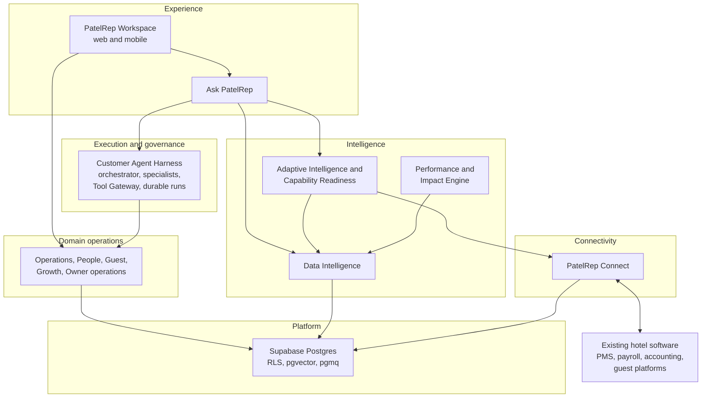

# 04 — Platform Architecture

> **Status:** The platform foundations are founder-approved as **logical responsibilities**
> ([FD-25, FD-26](15-strategic-decision-register.md#1-founder-approved-decisions)). The layer model is **proposed
> architecture** (PA-01). The mapping to existing code is verified at the baseline below.
> **Baseline:** `origin/main` @ `90204d83` (2026-11-26). **Authority:** [README § Authority and precedence](README.md#authority-and-precedence).

## 1. Architectural principles

1. **Logical responsibilities, not services.** A foundation below is a responsibility with an owner and contracts. It
   becomes a separate service only when measured need justifies the operating cost (FD-25).
2. **Use what exists until scale justifies more.** Supabase Postgres (RLS, pgvector, pgmq), the FastAPI API, Railway
   and the existing GitHub control plane stay the default. ADR-0001 records the same cost reasoning for the agent
   stack ([agent-harness/adr-0001-initial-agent-stack.md](../agent-harness/adr-0001-initial-agent-stack.md)).
3. **One operation, two callers.** Agents and screens call the same authorized business operation
   ([agent-harness/ai-ready-feature-standard.md](../agent-harness/ai-ready-feature-standard.md)).
4. **Enforcement lives as low as it can.** Tenant isolation is enforced by `hotel_id` scoping in every API query (the
   API's service-role connection bypasses RLS, which protects direct client access); agent authority is enforced in
   the database (DEFINER RPCs, guards, triggers and the least-privileged worker role)
   ([agent-harness/security.md](../agent-harness/security.md)).
5. **Flat domain code.** Business logic stays in domain routers; `services/` only when shared by two or more domains
   (`CLAUDE.md` A1). New foundations that are genuinely shared (Connect, readiness, metrics) qualify.
6. **Bounded realtime.** Realtime subscriptions stay on the surfaces `CLAUDE.md` A2 lists; anything else pulls or uses
   notifications unless a reviewed decision widens it (TD-07).
7. **Forward-only change.** New migrations only; flags default off; deploy is not release.

## 2. Logical architecture

A separate **development and delivery plane** (Developer Harness V2/V3, CI Gate, Staging, Production Release,
Release Engineer) changes the repository. It never holds customer authority (§7).

## 3. Foundations and where they live today

| Foundation | Responsibility | Existing implementation | Status at baseline | Home document |
|---|---|---|---|---|
| Developer Harness V3 | Autonomous development, testing, review, recovery, CI and authorized releases | `scripts/developer-harness-v3/`, [developer-harness-v3/](../developer-harness-v3/README.md); D3.2–D3.4 merged; D3.5 open as draft PR #255 | Inactive; V2 authoritative | [developer-harness-v3/09-roadmap.md](../developer-harness-v3/09-roadmap.md) |
| Customer Agent Harness | Secure customer-facing AI execution, specialists, tool governance, approvals, budgets, audit, recovery | `apps/api/services/agent_harness`, `agent_execution`, `agent_gateway`, `agent_orchestrator`, `agent_handoff`, `agent_billing`, `agent_control_center` | H0–H6 merged and default-disabled; H7 P1–P2 merged; no worker deployed | [agent-harness/roadmap.md](../agent-harness/roadmap.md) |
| PatelRep Connect | Integration framework, registries, sync, health, credentials, metering | Provider-specific code only: `services/opera` (OHIP sync, webhooks, SFTP report ingestion), `routers/integrations.py`, OPERA PDF import (`services/opera_pdf.py`), `services/sms` (Twilio), `services/email_delivery` (Resend), Stripe in `routers/billing.py` and `routers/webhooks.py`, Expo push in `services/notify.py` | No shared framework; OPERA paths behind `opera_pilot_enabled` (default false) | [05](05-integration-strategy.md) |
| Data Intelligence | Ingestion, history, knowledge retrieval, provenance, quality, analytics, prediction | Postgres history tables, SOP retrieval (`match_sop_chunks`, `services/ai/sop_rag.py`), `services/cleaning_estimates.py`, `services/staffing_forecast.py`, `services/engineering_insights.py`, `services/asset_reliability.py`, rule-based room-readiness predictions (`services/ai/predictions.py`), asset failure predictions (`services/ai/failure_predictions.py`) | Capability-specific; no shared provenance or quality layer | [08](08-data-intelligence-strategy.md) |
| Adaptive Intelligence and Capability Readiness | Requirement declarations, readiness states, deterministic checks | Precedents only (null-not-zero metrics, fail-closed flags, soft-skip jobs) | Not implemented as a layer | [07](07-adaptive-intelligence.md) |
| Performance and Impact Engine | Hours Returned, metric registry, attribution, improvement cycle | `services/reporting/definitions.py` (22 definitions), `metrics.py`, `management.py`, `routers/management_roi.py` | Operational KPIs active; Hours Returned not implemented | [09](09-performance-and-impact-engine.md) |
| Ask PatelRep | Universal conversational access, delegation, follow-up | `routers/ai_copilot.py`, `services/ai/`, mobile assistant and copilot screen ([MOBILE_HOUSEKEEPER_AI.md](../MOBILE_HOUSEKEEPER_AI.md)); the web `/ai` page is a retired redirect | Role- and flow-specific; separate from the harness | [06 §5](06-ai-and-autonomy-strategy.md#5-ask-patelrep) |
| PatelRep Workspace | Role-adaptive employee and management experience | `apps/web` (Next.js App Router, Design System V2 default), `apps/mobile` (Expo) | Active for six canonical roles | §6 |

## 4. Principal flows

**Human action.** Client → API (verified JWT, `require_role`, `hotel_id` scope) → domain operation → Postgres through
the service role (RLS bypassed; the `hotel_id` filter is the enforcement) → central notification policy
(`services/notify.py`).

**Agent action (inactive today).** Request, schedule or event → admission (verified identity, entitlement, runtime
controls) → durable run → orchestrator plan → specialist proposal → Tool Gateway (default-deny policy → approval →
budget → dispatch) → the same domain operation → database guards → append-only audit
([agent-harness/architecture.md](../agent-harness/architecture.md)).

**Integration (proposed).** Provider → Connect adapter that owns the credential → normalization to canonical models
with provenance → sync state and health → readiness inputs → consumers. External writes leave only through reviewed
operations and, for agents, the Tool Gateway ([05](05-integration-strategy.md)).

**Measurement (proposed).** Operational records and events → pure calculators → registry definitions with evidence
classes → Workspace views and Ask PatelRep answers ([09](09-performance-and-impact-engine.md)).

## 5. Deployment topology today

| Component | Platform | Notes |
|---|---|---|
| API | Railway (`noble-cooperation` service), FastAPI on Python 3.12 (`apps/api/Dockerfile`) | Hosts the in-process APScheduler cron jobs, which run only in production (`apps/api/core/scheduler.py`) |
| Web | Railway (`PatelRep` service) and Vercel | Same `apps/web` app against the same API; the role of the Vercel deployment is described inconsistently ([CF-07](15-strategic-decision-register.md#9-conflicts-and-recommended-resolutions)) |
| Mobile | Expo / EAS builds | `apps/mobile` |
| Database, auth, storage | Supabase | Postgres with RLS, pgvector, pgmq |
| SFTP receiver | Railway (`opera-sftp` service) | OPERA Cloud report ingestion path |
| Agent worker | Not deployed | Deployment needs separate authorization |
| Control plane | GitHub Actions | CI Gate, Staging Candidate, Production Release and rollback, Release Engineer, Dependency Orchestrator (paused) |

Service identifiers and URLs are maintained in `CLAUDE.md` (Infrastructure) and are not repeated here.

## 6. PatelRep Workspace and roles

The Workspace is one role-adaptive experience (FD-02, FD-33). Its principles are in
[02 §4](02-product-constitution.md#4-experience-principles-patelrep-workspace-fd-33).

**Roles today.** Six canonical roles — `gm`, `housekeeping_supervisor`, `chief_engineer`, `engineer`, `front_desk`,
`housekeeper` — defined in `apps/api/core/roles.py`, carried in the `user_role` JWT claim set at login (migration 019
hook as corrected by migration 053), and composed into explicit role sets per capability (for example
`TASK_ASSIGNMENT_ROLES`, `DISCREPANCY_RESOLVER_ROLES`). A session carries exactly one role and one hotel. Custom roles
(migrations 028/029) inherit a canonical base role's API authorization and narrow only which modules are visible. Every role has mobile tabs (`apps/mobile/lib/navigation/roleTabs.ts`); housekeepers and
engineers do not use the web app (`apps/web/lib/utils/routeGuard.ts`). The mobile client also knows an `inspector`
label that the database and API do not accept ([CF-21](15-strategic-decision-register.md#9-conflicts-and-recommended-resolutions)).

**Roles the strategy needs.** Department heads beyond housekeeping and engineering, corporate and management-company
staff, accounting, HR and owners. Two architectural additions are proposed, both security-sensitive and deferred to
reviewed implementation:

* **Role expansion (PA-12, TD-09):** new canonical roles with explicit capability grants, never numeric ranks,
  following the existing capability → role pattern of the agent harness.
* **Organization and portfolio tenancy (PA-11, TD-08):** a layer above `hotel_id` so an owner or corporate user can
  see several properties, while every query and RLS policy keeps resolving to an explicit set of hotels the user may
  access. Cross-hotel data is never reachable through a single-hotel identity. A `tenant_groups` table already exists
  in the schema (migration 002) but no application code reads it ([CF-22](15-strategic-decision-register.md#9-conflicts-and-recommended-resolutions)).

## 7. Separation of planes

| Plane | Purpose | Authority |
|---|---|---|
| Customer plane | Product features and customer agents acting inside a hotel | Tenant-bound identities; Customer Agent Harness policy; human activation |
| Development plane | Changing the repository | Developer git identity; V2 policy (V3 when activated); never customer execution, grants, decide-v2 or billing ([developer-harness-v2/02-architecture-contract.md §6](../developer-harness-v2/02-architecture-contract.md)) |
| Delivery plane | Moving reviewed code to staging and production | Trusted workflows, rulesets and environments ([RELEASE_PROCESS.md](../RELEASE_PROCESS.md)) |

## 8. Scale triggers (when to add infrastructure)

New infrastructure is justified by measurement, not by the roadmap. Indicative triggers, each needing a reviewed ADR:

| Candidate | Trigger to evaluate it |
|---|---|
| Separate Connect worker | Sync workload measurably affects API latency or needs isolation of provider credentials beyond the API process |
| Analytics store separate from Postgres | Analytical queries measurably degrade operational queries, or retention needs exceed what the operational database should hold |
| Dedicated vector store | Retrieval quality or latency limits of pgvector are measured at real document volumes |
| Event streaming | Event volume or fan-out exceeds what transactional tables and pgmq handle within their limits |
| Agent worker deployment | Explicit activation decision after H7 P8 ([agent-harness/h7-rollout-plan.md](../agent-harness/h7-rollout-plan.md)) |

Open architectural decisions are listed in the
[decision register](15-strategic-decision-register.md#4-technical-decisions-deferred-to-implementation).
