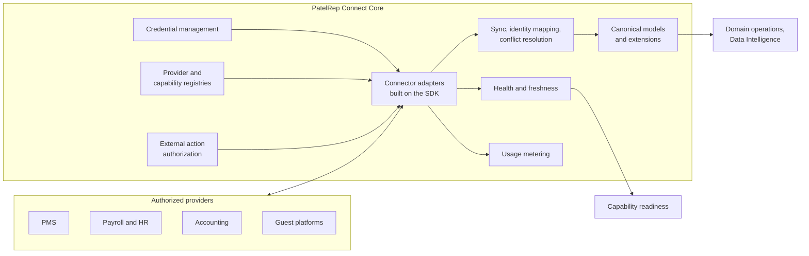

# 05 — Integration Strategy: PatelRep Connect

> **Status:** The principles and the list of Connect responsibilities in §4 are founder-approved (FD-06, FD-07, FD-09,
> FD-27, FD-28, FD-40 in the [decision register](15-strategic-decision-register.md#1-founder-approved-decisions)). How
> those responsibilities are structured into components, the canonical data model scope and the metering design are
> **proposed** (PA-04, PA-05, PA-13). **No commercial integration partnership is recorded in the repository, and none
> is claimed here.**
> **Baseline:** `origin/main` @ `90204d83` (2026-11-26). **Authority:** [README § Authority and precedence](README.md#authority-and-precedence).

## 1. Purpose

Hotels already pay for software that holds their reservations, payroll, accounts and guest conversations. PatelRep
Connect lets PatelRep use that information, under the hotel's authorization, so people stop re-entering facts and
PatelRep's capabilities light up as systems connect — without asking anyone to replace anything (FD-09).

## 2. Principles

1. **Integrate, do not replace.** The PMS, accounting, payroll, revenue management and guest platforms remain the
   systems of record (FD-07); PatelRep does not build competing guest-facing platforms (FD-06).
2. **Authorized access only.** Access is obtained through authorized developer accounts, commercial partnerships,
   customer consent and applicable certification. **PatelRep never bypasses a third party's access restrictions**
   (FD-27).
3. **The founder owns the agreements.** Commercial agreements, payments and third-party authorizations are handled by
   the founder; development work assists with research, implementation, testing and maintenance (FD-28).
4. **Standalone first.** Every floor workflow works with no integration at all (`CLAUDE.md` A4).
5. **One canonical model, provider extensions.** Consumers read canonical entities; provider-specific detail lives in
   extensions, so a new provider never changes a consumer.
6. **Credentials stay in adapters.** They never enter model context, tool arguments, traces or audit metadata
   ([agent-harness/architecture.md §7](../agent-harness/architecture.md)).
7. **Integration payloads are untrusted input**, exactly like user prompts — including reservation notes, guest
   messages and report files.
8. **Writes to external systems are exceptional.** They happen only through reviewed, authorized domain operations;
   agents are additionally bound by the Customer Agent Harness risk model, under which PMS modifications and guest
   communication are prohibited and external effects are never level 3 ([06 §4](06-ai-and-autonomy-strategy.md#4-effect-based-risk-boundaries)).
9. **Costs are visible** before a hotel connects a provider ([11 §8](11-commercial-strategy.md#8-integration-expenses)).

## 3. Integration modes

| Mode | Use when | Notes |
|---|---|---|
| Official APIs and authorized business events (webhooks) | The provider offers them to authorized developers or partners | Preferred: fresh, structured, revocable |
| Unified integration providers | One provider covers many systems in a category on commercially advantageous terms | Evaluated per category (ED-06); adds a dependency and a cost |
| Authorized scheduled reports and secure file transfer | The provider supports scheduled exports (for example SFTP report delivery) | Already used for OPERA Cloud reports; freshness limited by schedule |
| Authorized document imports | A hotel can export a document (for example a PDF report) | Already used for OPERA PDF import; good onboarding path |
| Manual entry | No authorized automated path exists | Always available; readiness states make the difference visible |

**Not an approved mode:** automating a provider's user interface (screen scraping, computer-use or credential replay)
without the provider's written authorization. An unmerged historical plan proposed this for OPERA
([CF-18](15-strategic-decision-register.md#9-conflicts-and-recommended-resolutions)); it is incompatible with FD-27.

## 4. Connect Core components

| Component | Responsibility | Existing precedent |
|---|---|---|
| Connector SDK | A small contract every adapter implements: authenticate, discover capabilities, read, optionally write, report health and usage | None; OPERA code is provider-specific (`apps/api/services/opera/`) |
| Provider registry | Which providers exist, versions, modes, regions, cost model, status | None |
| Capability registry | Dotted capability ids per provider (for example `pms.reservations.read`, `pms.room_status.write`) consumed by readiness declarations ([07 §3](07-adaptive-intelligence.md#3-the-capability-readiness-declaration)) | None |
| Canonical models and extensions | Provider-neutral entities (§5) plus provider-specific fields | `opera_reservations` table is OPERA-shaped |
| Identity mapping | External ids ↔ PatelRep ids for properties, rooms, reservations and people; person matches always confirmed by a human | None |
| Sync and conflict resolution | Pull, push, webhooks, idempotency, retries, conflict policy per field | `integration_sync_conflicts` with human local-wins / remote-wins decisions and append-only events (guest-name conflicts only); SFTP file idempotency |
| Source-of-truth selection | Per field, which system wins and when PatelRep may write | `CLAUDE.md` A4 deferral of two-way sync |
| Credential management | Per-tenant secrets, rotation, revocation, audit | Application-level field encryption for OPERA secrets; no vault (TD-03) |
| Health and monitoring | Freshness, error rates, last good sync, readiness inputs | `cron_health`; needs per-tenant, per-capability honesty ([CF-28](15-strategic-decision-register.md#9-conflicts-and-recommended-resolutions)) |
| External action authorization | Which writes exist, who may trigger them, approvals, audit; agents only through the Tool Gateway | Tool Gateway pattern ([agent-harness/tool-gateway.md](../agent-harness/tool-gateway.md)) |
| Usage metering and cost governance | Calls, volume and fees per provider and property (§7) | AI credit ledger pattern |
| Self-service onboarding | Hotel-initiated connection with consent, scopes and test | Integrations settings page for OPERA |
| Lifecycle and compatibility testing | Version pinning, contract tests against provider sandboxes, deprecation | None |

## 5. Canonical hotel data model (proposed scope)

| Entity | Typical source of truth | PatelRep role |
|---|---|---|
| Property, building, room, room type | PMS, or PatelRep for hotels without one | Consume; native where needed |
| Reservation and stay (arrival, departure, in-house, status) | PMS | Consume |
| Occupancy and demand forecast | PMS or revenue system | Consume |
| Room status (clean, inspected, out of order) | Shared: PatelRep for operations, PMS for sale | Produce operationally; write back only through a reviewed operation |
| Guest (minimal contact and preferences needed for operations) | PMS or guest platform | Consume minimally; never build a guest profile platform |
| Employee identity link, schedule, time record | PatelRep for operations; payroll or HR system for pay | Produce schedules; export or sync time records |
| Pay-period export | Payroll provider | Produce exports; never process payroll |
| General ledger lines, P&L | Accounting system | Consume read-only |
| Review and rating | Reputation platform | Consume |
| Rates and revenue metrics | PMS or revenue system | Consume |
| Work orders and assets from an external CMMS | That system, when a hotel has one | Consume or coordinate; native otherwise |

## 6. Current state

| Integration | What exists | Default state |
|---|---|---|
| OPERA Cloud (OHIP API) | Client-credential or password-grant authentication; arrivals for today and tomorrow every 30 minutes; a 90-day history pull on connect | Behind `tenants.opera_pilot_enabled` (default false); the OAuth-state table from migration 034 is unused |
| OPERA webhooks | Event receiver with signature verification required in production | No application code writes the per-hotel webhook secret (it is only read), so production verification fails closed unless a secret is set by other means; the signing scheme is unverified against a live sandbox |
| OPERA SFTP reports | Ingestion of "Reservation Detail" (arrivals) and "Guests INH - By Room" (in-house) with per-file idempotency, through the `opera-sftp` receiver service | Behind the pilot flag; report times are stored as UTC without hotel-timezone conversion, a data-quality limitation |
| OPERA PDF import | Housekeeping import of OPERA PDF reports | Not pilot-gated |
| OPERA write-back | A room-status push function exists | Not called anywhere |
| Stripe | Checkout, webhooks, monthly true-up | Requires credentials |
| Twilio | Staff-initiated guest SMS with consent and opt-out; replies within a window | Without credentials messages stay `queued` (`sms_provider_not_configured`) |
| Resend | Report and summary email | Without credentials, or in staging, delivery reports itself unconfigured and the daily summary counts `emails_not_configured` |
| Expo push | Staff notifications through the central policy | Active |
| AI providers | OpenAI and Anthropic with server-held keys | Missing key → feature unavailable |

There is no generic connector, provider registry, canonical model or credential vault today, and the forward
staffing forecast cannot see future days because the current reservation feed covers only today's and tomorrow's
arrivals and does not refresh cancellations ([10 §6](10-employee-protection-policy.md#6-existing-functionality-to-review-recommendations-not-findings-of-harm)).

## 7. Usage metering and cost governance

* Every adapter reports calls, data volume and provider fees per property and capability.
* Paid calls pass a pre-flight budget check, as AI calls already do; a refused call costs nothing.
* Integration cost per property feeds the internal margin view ([11 §6](11-commercial-strategy.md#6-cost-tracking-per-property)).
* Thresholds alert the founder before a property becomes unprofitable to serve; customers see only costs they agreed to.

## 8. Provider priorities (proposed)

Ordered by pilot need and customer value, subject to authorized access (ED-01 to ED-06):

1. **PMS** — OPERA Cloud first, because code and the pilot path exist; harden the read side (reservations including
   departures and cancellations, in-house, room status) before any write.
2. **Payroll and timekeeping** — start with exports a scheduler can hand to payroll; API integration after legal review.
3. **Accounting** — read-only financial data for owner intelligence.
4. **Guest messaging and reputation** — read and coordinate; no competing guest platform.
5. **Revenue management and channel systems** — read-only demand and rate context.

Unified integration providers are evaluated per category when they reduce cost or time to coverage.

## 9. Security and authorization for integrations

* Each connection records who authorized it, the scopes granted, the consent text version and how to revoke it.
* Credentials are tenant-bound, encrypted, rotated and never logged; revocation removes access immediately.
* Webhooks are verified; files are validated; every payload is treated as untrusted.
* Integration data is tenant-scoped and feeds readiness, never authority ([07 §6](07-adaptive-intelligence.md#6-readiness-is-not-authorization)).
* Security review is required for any new external write, credential mechanism or cross-tenant data path
  ([13 §4](13-security-privacy-and-governance.md#4-security-principles-for-the-new-foundations)).

## 10. Integration lifecycle

Evaluate the provider → founder obtains authorization (agreements, developer access, certification) → build against
the provider sandbox with contract tests → staging with a sandbox only ([ENVIRONMENTS.md](../ENVIRONMENTS.md)) →
pilot tenant through an entitlement → monitor health and cost → handle provider version changes and deprecations →
offboard with credential revocation and data handling per the retention rules.

## 11. Milestones

Connect Core milestones W4-C1 to W4-C6 are defined in the [master roadmap](03-master-product-roadmap.md#w4--build-patelrep-connect-core).
