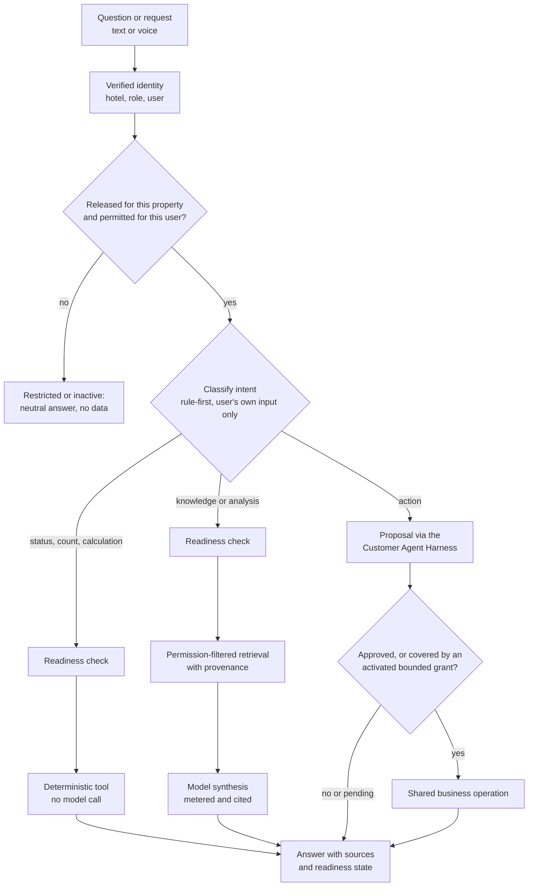
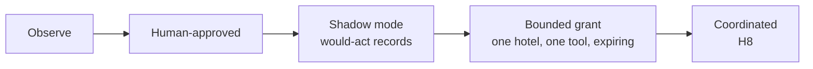

# 06 — AI and Autonomy Strategy

> **Status:** Goals, the founder restrictions and the Ask PatelRep principles and long-term capability set are
> founder-approved (FD-04, FD-11, FD-12, FD-23, FD-24, FD-32 in the
> [decision register](15-strategic-decision-register.md#1-founder-approved-decisions)). The Ask PatelRep pipeline
> (PA-06), memory model (PA-07), domain risk floors (PA-16) and the autonomy ladder diagram are **proposed**. The
> Customer Agent Harness contracts linked below remain authoritative and unchanged.
> **Baseline:** `origin/main` @ `90204d83` (2026-11-26). **Authority:** [README § Authority and precedence](README.md#authority-and-precedence).

## 1. Strategic intent

PatelRep pursues **maximum practical customer AI autonomy within strict risk-based authorization boundaries**
(FD-04). In practice that means: let AI take over as much administrative work, coordination and follow-up as can be
done safely, prove each step with evidence, and keep people in charge of every decision whose consequence is
financial, personnel, safety, guest-facing or external.

AI is a mechanism, not the product. Customers buy time returned and better operations ([01](01-company-vision.md));
whether a given result came from a rule, a deterministic tool or a model is an implementation detail chosen for
accuracy, cost and speed.

## 2. What this strategy does not change

* **The autonomy goal is not permission to loosen any Customer Agent Harness policy** (FD-24). Default deny, verified
  identity, digest-bound single-use approvals, database-side enforcement, emergency stops, worker isolation and audit
  stay exactly as specified in [agent-harness/security.md](../agent-harness/security.md),
  [agent-harness/contracts.md](../agent-harness/contracts.md) and the H-series ADRs.
* **Developer agents never activate customer execution**, grants, decide-v2 or billing
  ([developer-harness-v2/02-architecture-contract.md §6](../developer-harness-v2/02-architecture-contract.md)).
* **No activation is implied by any document or phase**: worker deployment, worker credentials, production execution,
  paid model calls, `enforced` customer billing, enabling `ai_agents` / `ai_control_center` for a real hotel and the
  platform autonomy switch each require their own explicit request
  ([agent-harness/h7-rollout-plan.md §4](../agent-harness/h7-rollout-plan.md)).
* The founder's restrictions against **autonomous phone calls** and **autonomous vendor communications** stay in force
  until changed by a future reviewed decision (FD-23, §4.2).

## 3. Autonomy model and current ceilings

The four levels are already defined in code (`apps/api/services/agent_harness/vocabulary.py`, `AutonomyLevel`):

| Level | Meaning (from code) | Where it stands at `90204d83` |
|---|---|---|
| 1 Observe | Observation and recommendations only; no writes | Read tools exist (H2/H5); the harness is default-disabled and no worker is deployed |
| 2 Human-approved | Writes only with a valid, server-recorded human approval | Two writes exist (`engineering.work_orders.assign` v2, `housekeeping.room_assignments.assign` v1); default-disabled, isolated-database tested, production refused in code |
| 3 Bounded | Expressly granted low-risk writes without per-action approval | **Unreachable**: `POLICY_AUTONOMY_CEILING = HUMAN_APPROVED`, `agent_tool_grants.max_level CHECK (1, 2)`; H7 Phase 1 (design) and Phase 2 (migration 262, verified human identity) are merged, Phases 3–8 are not started on `main` |
| 4 Coordinated | Longer-running authorized coordination | H8, future; not designed |

Two rules hold at every level:

* Consequences `financial`, `personnel` and `safety` are in `HUMAN_AUTHORITY_CONSEQUENCES` and can never be unlocked
  by an autonomy level; H7 adds `guest_facing` and every external-system effect to the "never level 3" set
  ([agent-harness/risk-model-h7.md §2](../agent-harness/risk-model-h7.md)).
* The database, not Python and not a model, is the final enforcement point for any autonomous write
  ([agent-harness/adr-0006-h7-bounded-autonomy.md](../agent-harness/adr-0006-h7-bounded-autonomy.md), D4).

## 4. Effect-based risk boundaries

### 4.1 Existing classification

The H7 risk model classifies by **effect**, not by agent or model
([agent-harness/risk-model-h7.md](../agent-harness/risk-model-h7.md)). Summary:

| Effect | H7 decision |
|---|---|
| Read-only operational observation | L1 |
| Internal advisory flag; internal review record | L3 eligible (first candidates, not implemented) |
| Work-order assignment, priority, due date, status | L2 required |
| Housekeeping room assignment (personnel) | L2 required, never L3 |
| Inspection pass, releasing a room as ready | Prohibited for agents |
| Guest communication (SMS, messages, notes) | Prohibited |
| PMS modifications (room status, reservations, folios) | Prohibited |
| Financial, payroll, billing | Prohibited |
| Security and emergency decisions | Prohibited, human only |
| Staff messaging and nudges | L2 required in H7 |

### 4.2 Founder restrictions carried forward (FD-23)

* **No autonomous phone calls.** No agent places, answers or conducts a voice call on behalf of a hotel or a person.
* **No autonomous vendor communications.** No agent contacts, instructs, negotiates with or messages a vendor.
  Recording a vendor engagement entered by staff is ordinary product functionality (the existing `contact_vendor`
  route in `apps/api/routers/vendors.py` records an engagement and an audit row and sends nothing externally); sending
  anything to the vendor is not an agent capability.

Repository evidence: no executable contract on `main` names telephony or vendor messaging explicitly. The nearest
encoded boundaries are the H7 rules above (external-system effects never level 3; guest communication prohibited) and
the H5 scope note that vendor contact is not in H5
([agent-harness/specialists-engineering.md](../agent-harness/specialists-engineering.md)). Encoding both restrictions
as explicit prohibited rows in the next reviewed risk-model revision is recommended ([CF-11](15-strategic-decision-register.md#9-conflicts-and-recommended-resolutions)).

### 4.3 Proposed risk floors for the capability domains (PA-16)

These are planning floors for future manifests, not new contracts. **A tool is classified no lower than in
[agent-harness/risk-model-h7.md](../agent-harness/risk-model-h7.md); these floors can only raise a classification,
never lower it.**

| Domain | Typical effects | Proposed floor |
|---|---|---|
| Operations | Advisory flags, review records, task and work-order coordination | As in the H7 risk model: work-order assignment, priority, due date and status are medium, L2 required; L3 only for effects that model marks low risk and L3 eligible (internal, additive, reversible, no person or guest affected) |
| People | Schedules, assignments, coverage, pay-affecting records | Personnel or financial: human authority, never L3 |
| Guest | Requests, recovery, anything a guest can see | Guest-facing: never L3; any guest communication by agents is prohibited |
| Growth | Rates, offers, reputation responses | Financial: human authority. Reputation responses and any guest or public communication: prohibited for agents |
| Owner | Financial analysis, reports | Reads; financial writes prohibited for agents |
| Connect | Writes to external systems | External effect: never L3 in H7; any agent write needs a future reviewed decision |

## 5. Ask PatelRep

Ask PatelRep is the universal conversational interface for every authorized user (FD-11): ask a question, get a
truthful answer, delegate work, and be followed up with proactively. Users never need to know which agent, API or
provider was involved.

### 5.1 Existing foundation

* **AI Copilot** (`apps/api/routers/ai_copilot.py`, mobile `app/(app)/copilot`; the web `(dashboard)/ai` page is now a
  retired redirect): intent parsing for tasks, work orders, guest requests and room assignment, SOP questions,
  insights, role briefings, shift recap, photo analysis, translation, confirm routes and usage, with SOP retrieval and
  citations (`services/ai/sop_rag.py`, `match_sop_chunks`). Natural-language task parsing has a free rule-based fast
  path before any model call.
* **Mobile housekeeper assistant** ([MOBILE_HOUSEKEEPER_AI.md](../MOBILE_HOUSEKEEPER_AI.md)): one assistant; answers
  built on the phone from loaded records cost nothing and work offline; server re-derives role and hotel from the
  verified JWT and re-checks every id; parsers return previews and nothing is created until the person confirms;
  on-device speech recognition with editable transcripts and no audio sent; a credit pre-flight runs before every paid
  call; new AI paths ship behind default-off tenant flags.
* **Legacy model routing:** `gpt-4o-mini` for parsing and translation, `claude-sonnet-4-6` for SOP answers,
  briefings and insights. Most services hard-code their model IDs; `services/ai/model_routing.py` and the per-hotel
  `ai_model_routes` overrides currently affect only failure prediction and repair assist. Credits are
  computed from actual tokens and a pre-check refuses calls at the hotel's cap before any provider spend
  (`middleware/credits.py`). Several AI calls are not yet metered through that path, including the nightly
  asset-failure prediction job and embedding calls ([CF-23](15-strategic-decision-register.md#9-conflicts-and-recommended-resolutions)).

This is a separate path from the Customer Agent Harness. Converging the two (one authorized operation, two callers)
is a deferred technical decision (TD-18, [CF-12](15-strategic-decision-register.md#9-conflicts-and-recommended-resolutions)).

### 5.2 Answer and action pipeline (proposed, PA-06)

The order matches the readiness precedence in [07 §4](07-adaptive-intelligence.md#4-readiness-states): release and
permission are checked before readiness, so a user without permission learns nothing about what data or integrations
exist. Intent classification is rule-first and sees only the user's own input.

Rules:

1. **Permissions are enforced before sensitive information reaches a model.** Retrieval is filtered by tenant, role and
   record-level rules; a model never receives data the user could not open in the app.
2. **Deterministic first.** Status checks, counts, calculations and ordinary lookups use deterministic tools. A model
   is used for language, synthesis and judgment, not arithmetic.
3. **Truthful partial answers.** When information is incomplete, stale or restricted, the answer says so and states
   what is known ([07 §4](07-adaptive-intelligence.md#4-readiness-states)). Missing data is never presented as zero.
4. **Evidence and provenance.** Factual claims cite their source records, documents or public pages.
5. **Actions are proposals.** Conversation is never authority. Every effect goes through the harness's default-deny
   policy, approvals and the shared business operation; the user sees what will happen before it happens.
6. **Ordinary interfaces stay first-class.** Ask PatelRep never replaces a faster button (FD-33).
7. **Answers about people obey the employee protection policy.** No rankings, leaderboards or person-level
   comparisons beyond what [10 §2 and §4](10-employee-protection-policy.md#4-measurement-and-analytics-rules) allow,
   whatever the question; small-group suppression applies to every answer.

### 5.3 Long-term capability set

The capability list is founder-approved (FD-32); the dependencies and notes are proposed sequencing.

| Capability | Dependency before it can ship | Notes |
|---|---|---|
| General questions and explanations | Model access, cost controls | Available in the legacy copilot today for some roles |
| Hotel-specific knowledge | SOP and document retrieval with access rules | Exists for approved SOPs |
| Live business intelligence | Metric registry ([09](09-performance-and-impact-engine.md)), readiness | Deterministic metrics, model-written narrative |
| Natural follow-up | Conversation state per user | Exists within a session |
| Multilingual text and voice | i18n, speech | EN/ES UI; on-device speech for housekeepers |
| Authorized documents and images | Upload scanning, retention rules | Photo analysis exists behind a flag |
| Public-information research | Source citation, separation from tenant data | Future |
| Evidence-backed analysis and reporting | Data Intelligence provenance ([08](08-data-intelligence-strategy.md)) | Future |
| Permission-scoped memory | H8 memory with trust boundaries (PA-07) | Future |
| Task delegation and execution | Harness activation decisions per tool | Human-approved only, until H7 completes and a separate activation decision is made |
| Scheduled and event-driven workflows | H1 durable execution (`TriggerType` already has `schedule` and `event`) | Future |
| Proactive notifications and follow-up | Central notification policy, H7 outbox (P7) | Future |

### 5.4 Memory (proposed, PA-07)

Memory is scoped (user, role, property), visible to the person it concerns, correctable and deletable, never shared
across hotels, and treated as data, never as instructions. A memory can make an answer more relevant; it can never
grant access or authority. The design is part of H8 ([agent-harness/roadmap.md](../agent-harness/roadmap.md)).

## 6. Delegation, monitoring and proactive coordination

PatelRep supports work, not just answers (FD-12). The lifecycle of a delegated task:

1. **Request** from a person, a schedule or a domain event (`TriggerType`: `user_request`, `schedule`, `event`).
2. **Plan** by the orchestrator (H3), which holds no authority of its own.
3. **Propose** a tool call validated against reviewed contracts; a proposal never executes by itself.
4. **Authorize** through a human approval (level 2) or, once H7 is complete and activated, a bounded grant (level 3).
5. **Execute** through the same business operation the UI calls ([AI-ready standard](../agent-harness/ai-ready-feature-standard.md)).
6. **Monitor and follow up**: record the outcome, watch for completion or blockers, escalate to the responsible person.
7. **Validate** the outcome against its metric ([09 §6](09-performance-and-impact-engine.md#6-continuous-improvement-cycle)).

Coordinated autonomy (level 4, H8) chains these steps across departments with checkpoints; until H8 exists, each step
that changes something needs its own authorization.

## 7. Model strategy

* **Provider abstraction.** H3 adapters for OpenAI and Anthropic with capability-aware routing, a versioned price book
  and an atomic USD spend ledger; fallbacks are never more expensive
  ([agent-harness/orchestrator.md](../agent-harness/orchestrator.md)). The H3 catalog currently names `gpt-6-luna`,
  `gpt-6.1-terra`, `claude-haiku-5-5` and `claude-sonnet-5-5` (`services/agent_orchestrator/catalog.py`).
* **Actual usage, not estimates.** Every paid call is metered from provider-reported usage (`CLAUDE.md` A3).
* **Pre-flight before spend.** Allowance and readiness checks run before a paid call; a refusal costs nothing.
* **No automatic training on customer data** (FD-29; [08 §7](08-data-intelligence-strategy.md#7-customer-data-use-boundaries)).
* **Replaceable planners.** Frameworks stay replaceable; safety lives in the Tool Gateway and the database, not in the
  orchestration framework ([agent-harness/adr-0001-initial-agent-stack.md](../agent-harness/adr-0001-initial-agent-stack.md)).

## 8. Evaluation and assurance

AI features follow the evaluation rules in [14 §6](14-development-and-acceptance-standards.md#6-evaluation-requirements-for-ai-features).
Autonomous behavior additionally requires shadow mode before live execution (ADR-0006 D7), a staging rehearsal (H7 P8),
pilot evidence and a written readiness review. AI accuracy, execution reliability and cost per outcome are tracked as
registered metrics ([09 §5](09-performance-and-impact-engine.md#5-metric-families)).

## 9. Path to more autonomy

Each rung requires a reviewed contract, real-database tests, a staging rehearsal, pilot evidence and an explicit
activation decision for each hotel. Moving up is never automatic, never wildcard and never self-extending.

## 10. Open decisions

Delegation schema beyond depth 0 (TD-14), step-up authentication (TD-15), a mobile Control Center surface (TD-16),
convergence of legacy copilot routing with the harness catalog (TD-10, TD-18) and memory storage and retention (TD-11)
are recorded in the [decision register](15-strategic-decision-register.md#4-technical-decisions-deferred-to-implementation).
