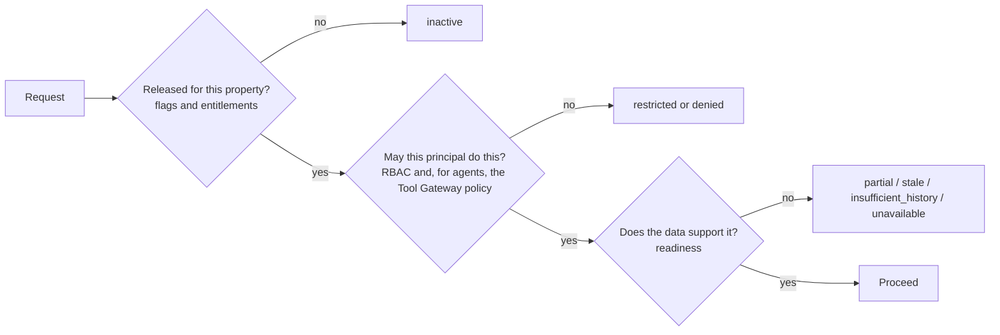

# 07 — Adaptive Intelligence and Capability Readiness

> **Status:** Founder-approved ([FD-30](15-strategic-decision-register.md#1-founder-approved-decisions)): the
> principles in §2, the declaration contents in §3 and the seven readiness states in §4. **Proposed** (PA-02): field
> names, the illustrative format, the state precedence, the evaluation design and milestones. Nothing in this document
> is implemented as a shared component today.
> **Baseline:** `origin/main` @ `90204d83` (2026-11-26). **Authority:** [README § Authority and precedence](README.md#authority-and-precedence).

## 1. Purpose

Hotels run very different technology stacks. One property has OPERA Cloud, a payroll provider and five years of
work-order history; another has a spreadsheet and a group chat. PatelRep must feel like **one consistent
application** at both, while what each capability can honestly do adapts to that property's actual software, data,
permissions and history.

Adaptive Intelligence is the discipline that makes this safe: every capability declares what it needs, a deterministic
check decides what it can do right now, and the product tells the truth about the result.

## 2. Founder-approved principles

1. Every agent, metric, workflow, prediction and automation declares its requirements (§3).
2. Readiness states are explicit: full, partial, stale, insufficient history, restricted, unavailable, inactive (§4).
3. Deterministic readiness checks run **before** any model invocation, so no model is called when a deterministic
   check shows the capability cannot succeed (§5).
4. **Missing data is never interpreted as zero or fabricated.**
5. An integration failure disables only the capabilities that depend on it (§7).
6. Functionality may improve as more authorized data becomes available, **without automatically granting new
   execution authority** (§6, §8).
7. The application stays universally consistent while functionality adapts per property.

## 3. The capability readiness declaration

Each capability (identified by a dotted id in the same style as the agent-harness capability catalog, for example
`housekeeping.room_readiness.forecast`) carries a declaration with these fields:

| Field | Meaning |
|---|---|
| `required_data` | Data without which the capability cannot run (entity, fields, source) |
| `optional_data` | Data that improves the result; its absence produces `partial`, never an error |
| `required_permissions` | Roles and scopes the *viewer or initiator* must hold; checked before data is read |
| `required_integration_capabilities` | Capability ids from the PatelRep Connect registry ([05 §4](05-integration-strategy.md#4-connect-core-components)), for example `pms.reservations.read` |
| `min_quality` | Completeness and validity thresholds per input (for example ≥ 95 % of rooms with a status) |
| `max_staleness` | Freshness limit per input (for example reservations synced ≤ 30 minutes ago) |
| `min_history` | Historical coverage needed (for example 28 days of clean sessions per room type) |
| `supported_actions` | What the capability may do: display, recommend, propose a tool call; never more than its consumer's authority |
| `fallback` | What the user sees and what the capability does in each non-full state |
| `activation` | Flag or entitlement key and rollout requirements ([FEATURE_FLAGS.md](../FEATURE_FLAGS.md)) |

Proposed shape (illustrative; the storage format is a deferred technical decision, TD-12):

```yaml
capability: housekeeping.room_readiness.forecast
version: 1
required_data:
  - { entity: room_status, fields: [status, updated_at], source: native }
optional_data:
  - { entity: reservation, fields: [arrival_eta, departure], source: "connect:pms.reservations.read" }
required_permissions: { roles: [gm, housekeeping_supervisor, front_desk] }
min_quality: { room_status.coverage: 0.95 }
max_staleness: { room_status: PT10M, reservation: PT30M }
min_history: { clean_sessions_per_room_type: P28D }
supported_actions: [display, recommend]
fallback:
  partial: "Show readiness from room status only; label arrival-based ordering as unavailable"
  insufficient_history: "Show current status; hide ETA estimates until history is sufficient"
  unavailable: "Show the room board without forecasts"
activation: { flag: null, entitlement: null }
```

## 4. Readiness states

| State | Definition | What the user sees | What automation may do |
|---|---|---|---|
| `full` | All required and optional inputs present, fresh and of sufficient quality and history | The complete capability | Whatever the capability supports, subject to authorization (§6) |
| `partial` | Required inputs satisfied; one or more optional inputs missing | The result plus a plain statement of what is missing and why it matters | Only actions that do not depend on the missing inputs |
| `stale` | A required input exceeds `max_staleness` | Last known result, timestamped, clearly marked as stale | Display only; no new recommendations or proposals from stale facts |
| `insufficient_history` | Inputs present but historical coverage below `min_history` | Current facts; predictions and baselines withheld with the remaining coverage shown (for example "9 of 28 days") | No predictions, no benchmarks |
| `restricted` | Data exists but the viewer lacks permission | Nothing from the restricted data; a neutral message, never a hint of its content | None on the viewer's behalf |
| `unavailable` | A required input or integration is missing or failing, or the readiness check itself failed | What still works, and who can fix the gap (for example "OPERA connection needs attention — your GM has been told") | None |
| `inactive` | The capability is not enabled for this property (flag, entitlement, contract or activation decision) | Nothing, or an explanation where discovery is helpful | None |

**Precedence** when several apply: `inactive` → `restricted` → `unavailable` → `stale` → `insufficient_history` →
`partial` → `full`. A failed or timed-out evaluation resolves to `unavailable`, never to `full` (fail closed).

## 5. Deterministic evaluation before model invocation

Readiness is computed by ordinary code from facts PatelRep already holds: flag and entitlement rows, integration
health records, sync timestamps, row counts, history windows and the requester's verified role. It never asks a model
whether data is good enough.

* Evaluation happens before retrieval and before any paid call, so a capability that cannot succeed spends nothing.
  The Customer Agent Harness already follows this pattern: H5 specialists gather verified context through the Tool
  Gateway before any paid call ([agent-harness/roadmap.md](../agent-harness/roadmap.md)).
* Results carry reason codes (for example `reservation_feed_stale`, `history_below_minimum`), mirroring the harness's
  reason-coded `allow` / `deny` / `requires_approval` decisions ([agent-harness/contracts.md](../agent-harness/contracts.md)).
* Results may be cached briefly per property and capability; the cache never outlives the shortest `max_staleness`.

## 6. Readiness is not authorization

Three independent questions decide what happens. Each can only narrow the others.



The order matches the precedence in §4: a principal without permission never learns whether data or integrations
exist.

* Entitlement and release control stay where they are today: tenant-scoped, fail-closed flags
  ([FEATURE_FLAGS.md](../FEATURE_FLAGS.md)) and the `ai_agents` / `ai_control_center` entitlements.
* Authorization stays with role gates and, for agents, the default-deny policy, approvals and database enforcement of
  the Customer Agent Harness ([agent-harness/security.md](../agent-harness/security.md)).
* **More data never means more authority.** A capability that becomes `full` because a payroll feed arrived can show
  better recommendations; it cannot start writing to payroll. New execution authority always comes from a reviewed
  change and an explicit activation decision ([06 §3](06-ai-and-autonomy-strategy.md#3-autonomy-model-and-current-ceilings)).

## 7. Failure isolation

* Capabilities form a dependency graph over data sources and integration capabilities. When an input fails, only the
  capabilities that require it change state; everything else keeps working.
* A failed integration never silently falls back to estimates presented as facts. If a fallback uses an estimate, the
  estimate is labeled ([09 §3](09-performance-and-impact-engine.md#3-evidence-classes)).
* State changes that need human action notify the role that can fix them (for example the GM for a disconnected
  integration), through the existing central notification policy rather than a new channel.
* Floor workflows (cleaning, inspections, work orders, logbook) must keep functioning natively when every integration
  is down. This preserves the existing rule that the app functions standalone first (`CLAUDE.md`, Opera Cloud A4).

## 8. Progressive enhancement

Capabilities are designed in tiers that light up as authorized data arrives:

| Tier | Typical inputs | Example (front-desk room readiness) |
|---|---|---|
| Native | PatelRep's own operational records | Live room board from housekeeping status |
| Connected | Authorized integration data | Arrival-aware ordering from PMS reservations |
| Historical | Sufficient local history | Expected-ready times from this property's own clean-time history |
| Predictive | History plus validated models | Forecasts with measured accuracy ([08 §6](08-data-intelligence-strategy.md#6-analytics-and-predictive-modeling)) |

Moving up a tier may change what is *shown or recommended*. A tier that would change what PatelRep *does* (writes,
messages, schedules) is a separate feature that goes through the normal rollout and, for agents, harness activation.

## 9. Existing precedents in the repository

The pattern is already present in several places, which is why it can become a platform rule rather than a rewrite:

| Precedent | Evidence |
|---|---|
| Missing labor time is returned as `None`, not `0`, and small samples are flagged `low_sample` | `apps/api/services/reporting/team.py` (`build_staff_metrics`) |
| A missing feature-flag row means OFF; database errors also resolve to OFF | [FEATURE_FLAGS.md](../FEATURE_FLAGS.md), `apps/api/core/feature_flags.py` |
| Tenant-iterating jobs soft-skip disabled tenants instead of failing | [FEATURE_FLAGS.md](../FEATURE_FLAGS.md) (Opera sync precedent) |
| The daily GM summary reports `emails_not_configured` instead of pretending to send | `CLAUDE.md` cron table |
| Developer metrics are reported as `NOT MEASURED` when no source exists | [developer-harness-v2/04-phase-roadmap-and-acceptance.md](../developer-harness-v2/04-phase-roadmap-and-acceptance.md) |
| Agent planning gathers verified facts through the gateway before any paid call | [agent-harness/roadmap.md](../agent-harness/roadmap.md) (H5) |
| Guest SMS without provider credentials stays `queued` with reason `sms_provider_not_configured`; email delivery reports itself unconfigured (`is_configured()` is false without credentials or in staging) | `apps/api/routers/guest_requests.py`, `apps/api/services/email_delivery.py` |
| Room-readiness predictions run only for rooms with a known upcoming check-in time, which today only the OPERA paths supply | `apps/api/services/ai/predictions.py` |

One counter-example shows why a shared rule is needed: the reservation-sync job records a successful run even when
every hotel was skipped, and the health endpoint reports that run as the PMS "last sync"
([CF-28](15-strategic-decision-register.md#9-conflicts-and-recommended-resolutions)). Under this strategy that state is
`inactive` or `unavailable`, never success.

## 10. Worked examples

1. **"How many rooms are ready?" in Ask PatelRep.** Deterministic: answered from room status with no model call.
   If the room-status feed from the PMS is stale but native status is current, the answer uses native status and says
   the PMS view may differ.
2. **Staffing coverage forecast.** Requires a published schedule (native); expected occupancy from the PMS is an
   optional input. Without a PMS feed the capability is `partial`: it shows scheduled coverage against the property's
   standard staffing guide and states that occupancy-driven forecasting is unavailable. It never invents occupancy.
3. **Hours Returned for a property without labor data.** Measured components that come from PatelRep timestamps are
   shown; components that need labor or payroll data are `unavailable`, and the total is labeled as partial rather
   than extrapolated ([09 §2](09-performance-and-impact-engine.md#2-hours-returned-the-north-star)).
4. **Integration outage.** The PMS connection fails at 07:10. Arrival-aware ordering becomes `unavailable`; cleaning,
   inspections and work orders continue; the GM is notified once, not every housekeeper.

## 11. Implementation path (proposed milestones)

| Milestone | Deliverable | Acceptance |
|---|---|---|
| R1 | Declaration schema, state vocabulary and reason codes as reviewed contracts with tests | Schema validated in CI; vocabulary used by at least one existing capability |
| R2 | Deterministic evaluator library for native inputs (freshness, coverage, history) | Unit tests per state and precedence; evaluation failure → `unavailable` |
| R3 | Integration-health inputs from PatelRep Connect | Simulated outage flips only dependent capabilities |
| R4 | Shared Workspace UI states (web and mobile) for every non-full state | EN/ES strings; accessibility; no zero substitution |
| R5 | Agents, metrics and Ask PatelRep consult readiness before acting or answering | Tests prove no model call occurs for a non-ready capability |

R1–R2 have no upstream dependencies and can run in parallel with other foundations; like every milestone, they start
only on explicit request ([03 §1](03-master-product-roadmap.md#1-how-to-read-this-roadmap)).
