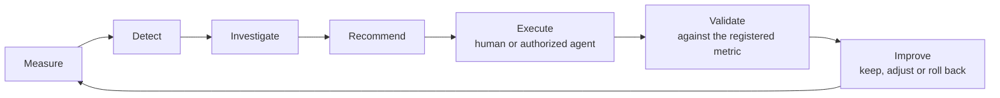

# 09 — Performance & Impact Engine

> **Status:** Founder-approved ([FD-31](15-strategic-decision-register.md#1-founder-approved-decisions)): Hours
> Returned as the North Star, the four evidence classes, the integrity rules (no double counting, no unsupported
> attribution, time recovered is not payroll savings), the metric families, the registry's required properties
> (formulas, provenance, reporting periods, permissions, validation, freshness) and the improvement cycle.
> **Proposed** (PA-03, PA-09): the formula, field names, attribution method and milestones. No customer outcome has
> been measured yet.
> **Baseline:** `origin/main` @ `90204d83` (2026-11-26). **Authority:** [README § Authority and precedence](README.md#authority-and-precedence).

## 1. Purpose

PatelRep sells measurable results, not AI technology (FD-21). The Performance & Impact Engine is how those results are
measured honestly: one registry of metric definitions, one set of evidence rules, and a continuous cycle that turns
measurements into improvements and checks that the improvements were real.

It extends what already exists. `apps/api/services/reporting/definitions.py` is today's metric definition registry
("the ONE place business definitions are written down", 22 entries served by `GET /v1/reports/definitions`), and
`apps/api/services/reporting/metrics.py` already enforces that empty-denominator rates and sample-less averages are
`None`, never `0`, and that averages ship their `sample_size`.

## 2. Hours Returned: the North Star

**Definition.** Hours Returned is the reduction in time people spend on work that does not need them —
administrative work, manual coordination, duplicate data entry, waiting, rework and searching for information —
that can be attributed to PatelRep for a property and period, **net of any time PatelRep itself adds**.

**Formula (proposed, per property, per period P).** For each leaf activity `a` of staff work:

```text
ExpectedBaselineTime(a) = rate_baseline(a) × driver_current(a) × t_baseline(a)
ActualTime(a)           = volume_current(a) × t_current(a)

HoursReturned(P) = Σ over leaf activities a [ ExpectedBaselineTime(a) − ActualTime(a) ]  −  t_added(P)
```

* `t_baseline(a)` and `t_current(a)` are **staff working time** per occurrence of `a` (for example minutes spent
  writing and reading one shift handover, minutes spent chasing room status by phone or radio), measured with the same
  method under comparable conditions (§4).
* `driver_current(a)` is the outside workload driver the activity scales with (occupied rooms, departures, shifts,
  work orders opened), and `rate_baseline(a)` is how often the activity happened per unit of that driver before the
  change. Expected baseline time is therefore what the old way would have cost at **today's** workload, so busier
  periods are not mistaken for savings, and work PatelRep **eliminates** (a duplicate entry that no longer happens)
  earns credit equal to the time it used to take.
* **Desired-volume activities** — issue reports, safety and near-miss reports, guest-request logging — are credited
  only for faster handling (`t_baseline − t_current` per occurrence). An increase in how often people report is
  never debited, so the metric creates no incentive against reporting ([10 §2](10-employee-protection-policy.md#2-prohibited-outcomes), P8).
* **Elapsed waiting is not staff time.** "Room ready → front-desk awareness" is a service-latency metric reported
  separately; only the staff time spent waiting or chasing counts toward Hours Returned.
* `t_added(P)` covers only work PatelRep introduces **outside** the taxonomy (training, confirmations that replace no
  measured activity). Time inside a measured activity is already in `t_current`. If `t_added` is not measured, the
  total is labeled an upper bound.
* Leaf activities come from a mutually exclusive activity taxonomy, so each minute is credited once (§4.1).

**Reporting.** The headline figure includes only **measured** contributions. Estimated contributions are shown
beside it, never inside it. Results are reported per property, department or role group, with the uncertainty
range and the conditions they were measured under — never per person, and never for a group small enough to
identify individuals (FD-35, [10 §4](10-employee-protection-policy.md#4-measurement-and-analytics-rules)).

**What Hours Returned is not.** It is not payroll savings, not a productivity quota and not a promise. Recovered time
can go to guests, quality, training, breaks or a calmer shift; that is a valid and intended outcome.

## 3. Evidence classes

| Class | Definition | Required provenance | May appear in |
|---|---|---|---|
| **Measured** | Directly observed in system records or a structured measurement study, using the same method before and after | Source records, method, sample size, conditions | Headline Hours Returned, ROI |
| **Estimated** | Derived from real inputs by a stated rule (for example standard times validated at this property) | The rule, its inputs, its validation | Beside the headline, labeled "estimate" |
| **Financially realized** | A cost or revenue change confirmed in authorized financial or payroll data (for example fewer overtime hours paid) | The financial record and the decision that realized it | ROI as realized value |
| **Potential opportunity** | An identified improvement not yet executed or validated | The detection that found it | Recommendations only, never totals |

When inputs are missing or insufficient, no figure is shown at all: the value is `unavailable`, a readiness state
([07 §4](07-adaptive-intelligence.md#4-readiness-states)), not a fifth evidence class. The first two classes map onto
the vocabulary the staffing forecast already uses (`verified` and `estimate`, with `unavailable` for missing inputs,
in `apps/api/services/staffing_forecast.py`); the existing registry already prefixes estimates with "ESTIMATE:" (for
example downtime revenue exposure).

## 4. Measurement integrity rules

### 4.1 No double counting

* Credit is assigned at leaf activities of one taxonomy; a parent's value is the sum of its leaves.
* When two mechanisms touch the same activity (for example voice reporting and automatic routing both shorten
  "issue reported → work started"), the activity is credited once and the split between mechanisms is reported as an
  analysis, not added twice.
* Customer ROI and Hours Returned use the same underlying records; financially realized value is never added to the
  valued time it came from.

### 4.2 Attribution

* A baseline is captured **before** a change, with the same method used afterward.
* Comparisons control for occupancy, staffing levels, service levels, room mix, seasonality and comparable work
  conditions; periods with major confounders (renovation, new management, a staffing change) are flagged or excluded.
* Changes PatelRep did not cause are not attributed to it. When causality is uncertain, the claim is downgraded to
  estimated or opportunity.

### 4.3 Time is not money until it is realized

Time recovered is **never** reported as payroll savings unless authorized payroll or financial data shows the change
and a human decided to realize it. Even then, employee protection rules apply: recovered time must not be used to
justify unsafe workloads or concealed shortages ([10 §2](10-employee-protection-policy.md#2-prohibited-outcomes)).

### 4.4 Quality guardrail

A time reduction accompanied by worse inspection results, more re-cleans, more repeat defects, more guest complaints or
any safety regression is reported as a trade-off and contributes nothing to Hours Returned.

### 4.5 Definitions are versioned

A metric definition change creates a new version. History keeps the version it was computed with; comparisons across
versions are labeled or recomputed.

## 5. Metric families

Each family is a registry namespace. Examples are indicative; each needs a reviewed definition before use.

| Family | Example metrics | Typical inputs | Native today? |
|---|---|---|---|
| Administrative and coordination time | Minutes per shift handover; minutes from issue report to assignment | Logbook, tasks, work orders | Partly |
| Waiting, duplicate work and rework | Room-ready → front-desk awareness; duplicate work orders; re-clean rate | Room status history, inspections | Partly |
| Staffing adequacy and coverage | Coverage gaps open; forecast short days; time to fill a gap | Scheduling, coverage gaps | Yes (housekeeping) |
| Overtime and labor efficiency | Overtime hours; paid hours per occupied room | Payroll/timekeeping integration | No (needs Connect) |
| Employee experience and fairness | Workload spread; schedule changes with short notice; pulse feedback | Assignments, schedules, surveys | Partly |
| Housekeeping quality and readiness | Inspection pass rate; rooms serviced; cleaning minutes | Existing registry entries | Yes |
| Engineering, PM and assets | Maintenance SLA, repair time, PM compliance, repeat defects, downtime | Existing registry entries | Yes |
| Guest experience and service resolution | Guest SLA, acknowledgment time, verified resolution | Existing registry entries | Yes |
| Financial performance and profitability | GOP, cost per occupied room, revenue exposure | Accounting/PMS integrations | Estimate only today |
| Inventory, utilities and sustainability | Spare-part stock-outs; meter readings; energy per occupied room | Inventory, readings, utility data | Partly |
| Safety and compliance | Training completion; drill follow-up; incident reporting latency | Safety, evidence modules | Partly |
| AI accuracy, reliability and cost | Answer accuracy on evaluation sets; proposal acceptance; cost per resolved request | AI usage logs, H3/H4 ledgers | Partly |
| Integration reliability and coverage | Sync freshness; failed syncs; share of capabilities `full` | PatelRep Connect health | No |
| Customer ROI | §8 | All of the above | No |
| Internal SaaS business | §9 | Billing and cost ledgers | Partly |

## 6. Continuous improvement cycle



* **Detect** uses deterministic thresholds and trends first; models may explain, not decide.
* **Recommend** produces proposals with expected impact and the evidence class of that expectation.
* **Execute** follows normal authorization: a person, or an agent within its approved authority
  ([06 §6](06-ai-and-autonomy-strategy.md#6-delegation-monitoring-and-proactive-coordination)).
* **Validate** compares against the baseline under §4 before any result is reported as achieved.

## 7. Metric registry architecture (proposed, PA-03)

The existing entry fields (`label`, `unit`, `higher_is_better`, `scope`, `definition`, `numerator`, `denominator`,
`cohort`, `exclusions`, `source`) are kept. Proposed additions:

| Field | Purpose |
|---|---|
| `id`, `version`, `owner` | Stable dotted identifier, versioning (§4.5) and accountability |
| `family` | One of §5 |
| `evidence_class` | Measured, estimated, financially realized or opportunity (§3) |
| `formula_ref` | The pure calculator that implements it (today's `metrics.py` style) |
| `grain` | Property, department, role group; whether person-level display is permitted at all; the minimum group size below which results are merged or suppressed ([10 §4](10-employee-protection-policy.md#4-measurement-and-analytics-rules)) |
| `reporting_periods` | Live, day, week, month, custom; hotel-local time |
| `baseline_method` | How the comparison point is captured (§4.2) |
| `attribution` | Which activities and mechanisms it credits (§4.1) |
| `permissions` | Roles that may view it; person-level visibility rules |
| `validation` | Range checks, completeness thresholds, minimum sample size |
| `freshness` / `min_history` | Readiness inputs ([07 §3](07-adaptive-intelligence.md#3-the-capability-readiness-declaration)) |
| `provenance` | Source tables or Connect capabilities, with lineage to records |
| `change_log` | What changed and why |

Computation stays in pure, fixture-testable calculators; scheduling and storage of computed values is a deferred
technical decision (TD-13).

## 8. Customer ROI

```text
ROI(P)        = FinanciallyRealized(P) / SubscriptionCost(P)
ValuedTime(P) = ( measured HoursReturned(P) − hours already counted in FinanciallyRealized(P) ) × customer-confirmed rate
```

* `FinanciallyRealized` only counts §3 financially realized value.
* `ValuedTime` is shown **beside** ROI, never added to it, labeled as valued time rather than savings, at a rate the
  customer chose and confirmed. Hours behind a realized saving (for example reduced overtime) are subtracted first, so
  nothing is counted twice (§4.1).
* Every component is displayed on its own with its evidence class; potential opportunities are never added in.

## 9. Internal SaaS business metrics

Internal only, never shown to hotels: recurring revenue, gross margin per property after AI, API, infrastructure,
onboarding and support cost ([11 §6](11-commercial-strategy.md#6-cost-tracking-per-property)), activation and time to
first value, retention, expansion, support load and integration cost per property. Sources are the billing and usage
ledgers; estimates are labeled as such.

## 10. Existing foundation

| Asset | Path | Use for the engine |
|---|---|---|
| Metric definition registry (22 entries) | `apps/api/services/reporting/definitions.py` | Seed of the registry; extend rather than replace |
| Pure calculators and metric contract | `apps/api/services/reporting/metrics.py` | Pattern for every calculator |
| Management ROI and Management Intelligence (GM only) | `apps/api/routers/management_roi.py`, `apps/api/services/reporting/management.py` | Repeat failures, downtime revenue exposure (labeled estimate), housekeeping minutes per room against the configured base, inspection trends, PM compliance, training readiness and a 7-day labor forecast from trailing averages. **No time-saved figure exists anywhere in the code** |
| Team metrics with null-not-zero and low-sample flags | `apps/api/services/reporting/team.py` | Person-level rules ([10 §4](10-employee-protection-policy.md#4-measurement-and-analytics-rules)) |
| Staffing forecast with evidence labels | `apps/api/services/staffing_forecast.py` | Coverage metrics and evidence vocabulary |
| Hotel cleaning-time estimates with hold-out validation | `apps/api/services/cleaning_estimates.py` | Validated standard times for estimates |
| AI usage from actual tokens; provider-spend and customer-billing ledgers | `apps/api/middleware/credits.py`; [agent-harness/orchestrator.md](../agent-harness/orchestrator.md); [agent-harness/customer-billing.md](../agent-harness/customer-billing.md) | AI cost and reliability metrics |
| Raw timing data | Clean-session durations, housekeeping shift sessions with breaks, work-order events and labor sessions, guest-request lifecycle timestamps | Measured components of Hours Returned |
| AI outcome data | Recommendation acceptance, override and false-positive records (migration 073, `services/ai/governance.py`); `is_ai_created` / `is_ai_suggested` flags | AI accuracy metrics; attribution needs care because `is_ai_created` is also set by non-AI automation |

Two cautions from the baseline audit: the registry and its calculators already disagree on two definitions (PM
compliance and the cleaning-minutes denominator), and no measured pre-adoption baseline exists anywhere — configured
standards such as `base_clean_minutes` are targets, not "before" measurements ([CF-27](15-strategic-decision-register.md#9-conflicts-and-recommended-resolutions)).
A test that pins every registry definition to its calculator is part of milestone I1.

## 11. Implementation path (proposed milestones)

| Milestone | Deliverable | Acceptance |
|---|---|---|
| I1 | Registry extension fields (§7) and the activity taxonomy for the pilot workflows | Existing 22 definitions migrate without behavior change; tests pin field completeness |
| I2 | Event instrumentation for pilot workflows (handover, issue reporting, room readiness, coverage) | Each event has a schema, a tenant scope and no person-level ranking output |
| I3 | Baseline capture for the pilot property ([12 §4](12-customer-pilot-strategy.md#4-baseline-measurement)) | Baseline locked before any pilot feature is enabled |
| I4 | Hours Returned calculator (measured components only) with uncertainty and conditions | Fixture tests for double counting, confounder flags and added time |
| I5 | Impact view for managers and owners in the Workspace | Every number shows its evidence class; unavailable states render honestly |
| I6 | Improvement-cycle loop: detection rules, recommendations, validation records | A recommendation cannot be marked "achieved" without a validation record |
