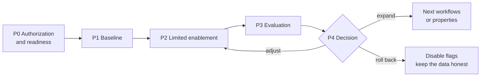

# 12 — Customer Pilot Strategy

> **Status:** Founder-approved ([FD-38](15-strategic-decision-register.md#1-founder-approved-decisions)): a pilot at the
> founder's hotel **subject to property approval**; the seven priority workflows; baselines before evaluation;
> accounting for occupancy, staffing, service levels, seasonality and comparable conditions; measuring employee
> feedback, guest outcomes, quality, safety and realized value; and evidence-based expansion and rollback criteria.
> **Proposed** (PA-20): the phases, methods and draft thresholds. This document authorizes no customer data
> collection, no paid model calls, no external integration and no production activation; each needs its own explicit
> approval.
> **Baseline:** `origin/main` @ `90204d83` (2026-11-26). **Authority:** [README § Authority and precedence](README.md#authority-and-precedence).

## 1. Purpose

The pilot answers one question with evidence: **does PatelRep give the people at a real hotel measurable time back,
without hurting guests, quality, safety or employees?** It is also where the Performance & Impact Engine, Capability
Readiness and the employee protection policy are first exercised on real work.

## 2. Pilot workflows (priority order)

| # | Workflow | What "better" means | Existing native foundation at `90204d83` |
|---|---|---|---|
| 1 | Shift handovers | Less time writing and reading handovers; fewer items lost between shifts | Logbook (`routers/logbook.py`); AI shift summaries (`logbook.shift-summary` job, which records "skipped" when no AI provider is configured); housekeeper handoff text built on the phone |
| 2 | Voice-based issue reporting | Faster, more complete reports from the floor; less walking to find someone | Mobile issue reporting from rooms, assets and work orders; voice input through on-device speech recognition (native builds only, no audio sent) feeding the task parser ([MOBILE_HOUSEKEEPER_AI.md](../MOBILE_HOUSEKEEPER_AI.md)) |
| 3 | Cross-department coordination | Fewer calls and radio chases; shorter time from report to the right person | Tasks, work orders and guest requests with role routing (`core/roles.py` `TASK_ASSIGNMENT_ROLES`); escalation ladder (`escalations.check`) |
| 4 | Housekeeping ↔ front desk room readiness | Shorter time from "room ready" to front-desk awareness; fewer status mismatches | Housekeeping board and inspections; room-status discrepancy reporting and resolution (`routers/rooms.py`); realtime room status visible to the front desk on the web housekeeping board and the mobile room-status tab. No "room ready" notification event exists yet (`services/notify.py`) — a likely early improvement |
| 5 | Staffing coverage assistance | Shortages seen earlier; gaps filled faster and fairly | Team scheduling, open shifts, offers and coverage gaps (`services/coverage_fill.py`); same-day housekeeping staffing forecast (`services/staffing_forecast.py`), with future days `unknown` until a reliable reservation feed exists |
| 6 | Conversational hotel knowledge | Answers to "how do we…" without finding a supervisor | SOP library with retrieval and citations (`services/ai/sop_rag.py`); AI Copilot |
| 7 | Management briefings | Less time assembling the morning picture | Daily GM summary email (needs Resend configuration; sent to the first active GM); AI role briefings charged in AI credits; Management Intelligence and reports (GM only) |

Each workflow is enabled only through its existing flags and the Feature Rollout workflow, after a Production Release
decision ([RELEASE_PROCESS.md](../RELEASE_PROCESS.md), [FEATURE_FLAGS.md](../FEATURE_FLAGS.md)).

## 3. Phases

| Phase | Proposed content | Exit criteria |
|---|---|---|
| P0 Authorization and readiness | Written property approval; data-handling agreement; written permission (or not) to use pilot results outside the property; pilot commercial terms (OC-06); staff communication in English and Spanish; readiness check per workflow ([07](07-adaptive-intelligence.md)); decision on AI provider keys and budgets; integration decisions (for example whether the OPERA pilot entitlement is enabled); the baseline definition, primary comparison, strata and thresholds (§5, §8); the minimum group size ([10 §4](10-employee-protection-policy.md#4-measurement-and-analytics-rules)) | Every approval recorded; no workflow depends on an unapproved integration or paid call; analysis plan fixed before any data is collected |
| P1 Baseline | Measure current time and outcomes for each workflow (§4) before any pilot change is enabled. The baseline is the property's **current practice, including any PatelRep features it already uses** | Baseline locked: method, sample, conditions recorded |
| P2 Limited enablement | Enable one or two workflows at a time for the property through Feature Rollout | Features stable; no prohibited outcome ([10 §2](10-employee-protection-policy.md#2-prohibited-outcomes)) |
| P3 Evaluation | Re-measure with the same methods under comparable conditions (§5); collect feedback (§6) | Evaluation report with evidence classes |
| P4 Decision | Expand, adjust or roll back using §8 | Decision recorded in the register |

Durations are set in P0 with the property; the baseline must span enough days to cover the property's typical
occupancy bands and weekday patterns.

## 4. Baseline measurement

| Source | Used for | Notes |
|---|---|---|
| System timestamps already recorded | Room-status changes, inspections, work-order and guest-request lifecycle, task completion, logbook entries | Highest-quality evidence; no extra staff effort |
| Structured work sampling | Activities with no system trace (handover writing and reading, searching for information, walking to find a person, radio or phone coordination) | With staff consent; recorded per activity and role group, never per named person; groups below the minimum size are merged |
| Short anonymous pulse surveys | Perceived workload, stress, clarity, usefulness | Same questions before and after; results shown only for groups at or above the minimum size |
| Quality and guest records | Inspection pass rate, re-clean rate, repeat defects, guest-request SLA and verified resolution | Existing metric definitions (`services/reporting/definitions.py`) |
| Safety records | Incidents, near misses, reporting latency | Must not fall because reporting became harder |
| Context log | Occupancy, staffing levels, events, outages, policy changes | Required to judge comparability |

## 5. Comparable conditions and evaluation

* Compare like with like: occupancy band, weekday, season, service level (for example the stayover-cleaning policy),
  room mix and staffing level. Report results per stratum, not only as one average; the strata that count are fixed in
  P0, before results exist.
* A single property's before/after comparison cannot separate seasonality on its own. Use same-period prior-year
  records where they exist, and enable workflows in stages so that not-yet-enabled workflows serve as a concurrent
  comparison.
* Normalize by workload drivers (per handover, per issue, per departure, per occupied room) so a busier week is not
  mistaken for a gain ([09 §2](09-performance-and-impact-engine.md#2-hours-returned-the-north-star)).
* Flag or exclude periods with confounders (renovation, new management, unusual groups, system outages, PMS or other
  integration changes, policy changes).
* Report measured Hours Returned separately from estimates ([09 §3](09-performance-and-impact-engine.md#3-evidence-classes));
  report realized financial value only from authorized financial data.
* State uncertainty. A difference inside normal variation is reported as "no measurable change".

## 6. Employee experience and protection

* Staff are told what is being measured and why, in their language, before the baseline starts.
* Pilot data is never used to evaluate, rank or discipline individuals ([10](10-employee-protection-policy.md)).
* Work sampling is consented and aggregated; anyone may decline to be observed.
* There is a simple feedback channel (in person and in the app) and a named person who reads it.
* Any sign of increased pace, pressure, unpaid admin work or hidden shortage stops the affected workflow for review.

## 7. Guest outcomes, quality and realized value

The pilot counts as successful only if guest outcomes and quality hold or improve while time is returned. Realized
value (for example less overtime) is reported only with the financial record behind it and the human decision that
realized it ([09 §4.3](09-performance-and-impact-engine.md#43-time-is-not-money-until-it-is-realized)).

## 8. Expansion and rollback criteria

Proposed criteria; final thresholds are fixed in P0 before any feature is enabled.

**Expand** a workflow when all hold:

1. Measured Hours Returned is positive beyond normal variation in the strata fixed in P0.
2. No regression in quality, guest outcomes or safety indicators.
3. Employee feedback is neutral or positive, with no unresolved protection concern.
4. Costs (AI, integrations, support) are within the pilot budget.
5. Readiness states behaved honestly, with no fabricated or zero-filled values found in review.

**Roll back** a workflow immediately on any of:

1. A safety incident or near miss plausibly linked to the workflow.
2. A prohibited outcome from [10 §2](10-employee-protection-policy.md#2-prohibited-outcomes).
3. A quality or guest-outcome regression beyond the threshold fixed in P0.
4. A data-integrity, privacy or security incident.
5. The property asks to stop.

Rollback uses the workflow's flag (`enabled: false` through Feature Rollout), keeps the measurements, and records why.
Every pilot change therefore ships behind a flag; features that already exist without a flag are part of the baseline,
not of the pilot's rollback scope.

## 9. Governance during the pilot

* Weekly review with the property: measurements, feedback, incidents, decisions.
* Every decision and threshold change is written down with its date; results are never rewritten afterward.
* Incidents follow [PRODUCTION_RUNBOOK.md](../PRODUCTION_RUNBOOK.md) and [13 §10](13-security-privacy-and-governance.md#10-incident-response-and-recovery).

## 10. What this pilot does not authorize

No customer data collection, paid model calls, external integrations, harness activation or production enablement
happens because this document exists. Each requires the property's written approval and a separate explicit decision
by the founder as repository owner, and the existing release, rollout and harness activation procedures apply
unchanged.
