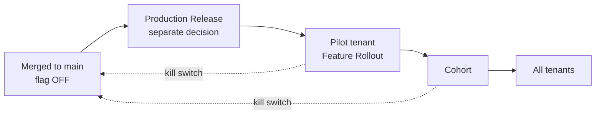

# 14 — Development and Acceptance Standards

> **Status:** The thirteen items every future implementation should identify are founder-specified for future
> adoption (FD-42). The Strategy Fit Record format, acceptance and evaluation standards and the rollout ladder are
> **proposed** (PA-14). Documentation only: this file changes no instruction file, workflow, gate, ruleset or
> enforcement mechanism.
> **Baseline:** `origin/main` @ `90204d83` (2026-11-26). **Authority:** [README § Authority and precedence](README.md#authority-and-precedence).

## 1. Purpose

Every future PatelRep product implementation should be able to answer one question before it is built and prove the
answer before it is released: **whose time does this give back, by how much, and at what risk?** This document turns
that question into a repeatable record (the Strategy Fit Record), acceptance standards, evaluation rules and a rollout
ladder that sit *on top of* the repository's existing, authoritative delivery controls.

These standards are written for future adoption. Integrating them into `CLAUDE.md`, `AGENTS.md`, the PR template or
automated governance is a separate, reviewed follow-up (§10). Nothing here is enforced today.

## 2. Existing controls these standards build on (unchanged)

| Control | Where it is defined | What it governs | Status |
|---|---|---|---|
| CI Gate | [`.github/workflows/ci.yml`](../../.github/workflows/ci.yml) | Single required check aggregating lint, type-check, build, API/web tests, Database Migration Gate, Security Scan, flag registry, frozen files, contrast, EN/ES parity, visual regression, workflow contracts | Active |
| Staging Candidate / Staging Gate | [`.github/workflows/staging-candidate.yml`](../../.github/workflows/staging-candidate.yml) | Deploys the exact CI-passed PR head to shared staging and reports Staging Gate | Active |
| Release process | [RELEASE_PROCESS.md](../RELEASE_PROCESS.md) | Human merge; Production Release is a separate, deliberate step; merge never deploys. Narrow exception: the Release Engineer recovery path ([AUTONOMOUS_RELEASE_ENGINEER.md](../AUTONOMOUS_RELEASE_ENGINEER.md)) | Active |
| Feature flags and rollout | [FEATURE_FLAGS.md](../FEATURE_FLAGS.md) | Tenant-scoped, fail-closed release control; deploy ≠ release; pilot → cohort → full | Active |
| Migration safety | [DATABASE_MIGRATIONS.md](../DATABASE_MIGRATIONS.md) | Forward-only migrations, expand → migrate → contract, destructive-SQL and security classifiers | Active |
| AI-ready feature standard | [agent-harness/ai-ready-feature-standard.md](../agent-harness/ai-ready-feature-standard.md) | One operation, two callers; the 15-item tool specification | Active standard |
| Developer Harness V2 | [developer-harness-v2/02-architecture-contract.md](../developer-harness-v2/02-architecture-contract.md) | Local policy, roles, smart test selection, CI suites; authoritative developer tooling | Active |
| Developer Harness V3 | [developer-harness-v3/README.md](../developer-harness-v3/README.md) | Future autonomous developer harness | Inactive until D3.9 activation |
| Release Engineer | [AUTONOMOUS_RELEASE_ENGINEER.md](../AUTONOMOUS_RELEASE_ENGINEER.md) | The only repair system for eligible CI/Staging failures | Active |
| Project instructions | [`CLAUDE.md`](../../CLAUDE.md), [`AGENTS.md`](../../AGENTS.md) | Development routing, authority boundaries, non-regression and self-verification policies | Active guidance |

The strategy adds product-fit requirements. It never relaxes, replaces or reinterprets any row above.

## 3. The Strategy Fit Record

Every product implementation (feature, agent, metric, prediction, workflow, integration or automation) should identify
the thirteen items below (FD-42); the proposed vehicle is a Strategy Fit Record (SFR, PA-14) in its design document or
PR description. Small fixes may answer
"not applicable" with a
reason; a blank item is not acceptable.

| # | Item | What a good answer contains |
|---|---|---|
| 1 | Customer problem | The concrete waste removed: admin work, coordination, duplicate entry, waiting, rework or fragmented information ([01](01-company-vision.md)) |
| 2 | Roles that benefit | Canonical roles from `apps/api/core/roles.py`, plus any role the feature needs that does not exist yet (flag it: new roles are security-sensitive, see [04 §6](04-platform-architecture.md#6-patelrep-workspace-and-roles)) |
| 3 | Expected outcome | Hours Returned or another registered metric, with the evidence class you expect to be able to claim ([09 §3](09-performance-and-impact-engine.md#3-evidence-classes)) |
| 4 | Required data and capabilities | Required and optional data, integrations, minimum history and freshness, declared as a readiness manifest ([07 §3](07-adaptive-intelligence.md#3-the-capability-readiness-declaration)) |
| 5 | Fallback behavior | What the user sees in every readiness state; missing data is never shown as zero |
| 6 | Permission and risk boundaries | Role gates equal to the domain route; tenant scoping; read/write; risk level; consequence class; approvals ([13](13-security-privacy-and-governance.md)) |
| 7 | AI-ready domain operations | Whether an agent will ever call it; if so, the shared operation and the 15-item specification from the [AI-ready standard](../agent-harness/ai-ready-feature-standard.md). A new screen does not automatically need an AI tool |
| 8 | Integration compatibility | Behavior with and without each relevant integration; source of truth per field ([05](05-integration-strategy.md)) |
| 9 | Employee protection implications | Answers to the checklist in [10 §5](10-employee-protection-policy.md#5-feature-review-checklist) |
| 10 | Testing and evaluation | Tests per §5; for AI, the evaluation plan per §6 |
| 11 | Measurement instrumentation | Which events are emitted, which metric definitions consume them, how the baseline is captured |
| 12 | Cost implications | Model, API, infrastructure and support cost per property; which budget or ledger records it ([11 §6](11-commercial-strategy.md#6-cost-tracking-per-property)) |
| 13 | Rollout and rollback | Flag key and category, staging evidence, pilot tenant, expansion criteria, kill switch and rollback or forward-fix path (§7) |

### 3.1 Template

```text
Strategy Fit Record
1. Customer problem:
2. Roles that benefit (existing / new):
3. Expected outcome (metric id, evidence class):
4. Required data and capabilities (readiness manifest link):
5. Fallback behavior per readiness state:
6. Permission and risk boundaries:
7. AI-ready domain operation (or "no agent access, because ..."):
8. Integration compatibility and source of truth:
9. Employee protection review (10 §5):
10. Testing and evaluation:
11. Measurement instrumentation and baseline:
12. Cost implications and metering:
13. Rollout, kill switch and rollback:
```

## 4. Status vocabulary for every claim

PR descriptions, release notes and strategy documents use the vocabulary already established by
[developer-harness-v3/01-verification-register.md](../developer-harness-v3/01-verification-register.md):
**implemented ≠ tested ≠ merged ≠ enabled ≠ exercised ≠ production-verified**. A capability is described by the
weakest stage it has actually reached, with evidence (commit, run id, check run, test name).

Outcome claims use the evidence classes in [09 §3](09-performance-and-impact-engine.md#3-evidence-classes):
measured, estimated, financially realized or potential opportunity. A number with no stated class or source is
reported as `NOT MEASURED`, the convention from
[developer-harness-v2/04-phase-roadmap-and-acceptance.md](../developer-harness-v2/04-phase-roadmap-and-acceptance.md).

## 5. Acceptance standards

| Dimension | Acceptance requirement | Required evidence |
|---|---|---|
| Customer outcome | The SFR names a measurable outcome and the metric exists in the registry (or is added with the feature) | SFR items 1–3, metric definition |
| Functional | Golden path works for every role in item 2, on every surface the feature claims (web, mobile, API) | Tests plus self-verification per `CLAUDE.md` |
| Non-regression | Every feature sharing code paths, routes or data is identified and its golden path re-verified (`CLAUDE.md` Non-Regression Policy) | Adjacent-feature list and results |
| Security and authorization | Tenant scoping, role gates equal to the domain route, no identity fields in inputs, fail-closed on missing context | Role-matrix tests, cross-hotel tests, forged-identity tests |
| Readiness | Every readiness state renders an honest state; deterministic readiness checks run before any model call | Readiness manifest and state tests ([07](07-adaptive-intelligence.md)) |
| Measurement | Events emitted; baseline capture defined; no double counting with existing metrics | Event schema, metric registry entry ([09](09-performance-and-impact-engine.md)) |
| Employee protection | Checklist in [10 §5](10-employee-protection-policy.md#5-feature-review-checklist) answered; any "yes" has a mitigation or a human decision | Recorded review |
| AI quality | Evaluation per §6 meets thresholds fixed before evaluation | Evaluation report |
| Cost | Expected per-property cost stated; usage metered from actual provider responses (`CLAUDE.md` A3) | Cost estimate, ledger path |
| Language and accessibility | EN/ES parity and contrast gates pass; floor-staff flows usable one-handed on a phone | CI gates, device check |
| Rollout and rollback | Flag registered in both registries, default off; kill switch tested; rollback or forward-fix written down | Flag registry entry, rollout plan |
| Documentation | Status claims use §4 vocabulary; decision register updated when a strategic decision changes | Doc diff |

## 6. Evaluation requirements for AI features

An AI feature is not accepted on demonstrations. Before it reaches a pilot tenant:

1. **Thresholds first.** Accuracy, refusal, latency and cost thresholds are written down before the evaluation runs.
2. **Representative evaluation set.** Built from authorized, de-identified or synthetic hotel data; never from
   another customer's data without authorization ([08 §7](08-data-intelligence-strategy.md#7-customer-data-use-boundaries)).
3. **Ground truth from people who do the work.** Housekeeping, engineering and front-desk answers are labeled by
   staff in those roles or by the SOP source, not by the model.
4. **Adversarial cases.** Prompt injection through SOPs, guest messages and integration payloads (untrusted input per
   [agent-harness/security.md](../agent-harness/security.md)); permission-leak probes across roles and hotels.
5. **Truthfulness cases.** Questions whose honest answer is "partial", "stale" or "unknown"; the feature must say so.
6. **Deterministic baseline.** Where a deterministic tool can answer (status, counts, calculations), the AI path must
   not be worse than the deterministic path, and the deterministic path is preferred ([06 §5](06-ai-and-autonomy-strategy.md#5-ask-patelrep)).
7. **Regression on change.** A model, prompt, tool-version or retrieval change re-runs the evaluation.
8. **Human review sampling in pilot.** A recorded sample of real interactions is reviewed for accuracy and safety.

## 7. Rollout and activation ladder



* Code reaches production only through Production Release; a merge never deploys it
  ([RELEASE_PROCESS.md](../RELEASE_PROCESS.md)). A new flag is deployed disabled for every tenant.
* Each rung needs evidence from the previous one (staging verification, pilot measurements, no unresolved incidents).
* **Customer Agent Harness activation is never implied by any rung.** Worker deployment, worker credentials,
  production execution, paid model calls, `enforced` billing, enabling `ai_agents`/`ai_control_center` for a real
  hotel and the platform autonomy switch each need their own explicit request
  ([agent-harness/h7-rollout-plan.md §4](../agent-harness/h7-rollout-plan.md)).
* Rollback criteria are written before the pilot begins ([12 §8](12-customer-pilot-strategy.md#8-expansion-and-rollback-criteria)).

## 8. Definition of Ready and Definition of Done

**Ready to build** when: the SFR is complete; dependencies named in [03](03-master-product-roadmap.md) are met or
explicitly stubbed with a readiness state; risk and consequence class are assigned; the approvals the feature will
need are identified; and any new role, migration, integration or credential is flagged for security review.

**Done** means what `CLAUDE.md` already says it means: a PR from a dedicated branch, CI Gate and Staging Gate green on
the exact head, and `ready_for_human_review`, which is never permission to merge. Strategy-level done adds: metric
baseline capture is live (or explicitly scheduled for the pilot), readiness states are verified, and the decision
register reflects any changed decision. Released, enabled and production-verified are separate later states.

## 9. Documentation standards

* No invented research, partnerships, customer outcomes or capabilities. Unknowns are written as unknown.
* Repository-relative links to authoritative contracts instead of copying their content.
* Absolute dates (for example 2026-11-26), never "recently" or "next week".
* Files stay under 500 lines; one home document per concept, others link to it.
* A strategic decision changes only through the [decision register](15-strategic-decision-register.md) in a reviewed PR.

## 10. Adoption plan (recommended follow-up; not performed in this PR)

| Step | Change | Classification |
|---|---|---|
| A1 | Generalize the `CLAUDE.md` "code decision filter" from housekeepers and engineers to everyone in hospitality, and point to this strategy (resolves [CF-03](15-strategic-decision-register.md#9-conflicts-and-recommended-resolutions)) | Instruction change, reviewed PR |
| A2 | Add a short "Strategy fit" section to [`.github/PULL_REQUEST_TEMPLATE.md`](../../.github/PULL_REQUEST_TEMPLATE.md) | Repository process, reviewed PR |
| A3 | Point `AGENTS.md` at the strategy README (it intentionally holds no facts of its own) | Instruction change, reviewed PR |
| A4 | Teach the V2 risk router and testing rules about SFR-relevant paths if useful | Developer-harness change, reviewed PR |
| A5 | Optional automated check that a PR touching product code carries an SFR | Control-plane work (`.github/workflows/**`), human-approved PR |

Each step is separate, reviewed work. This PR performs none of them.
